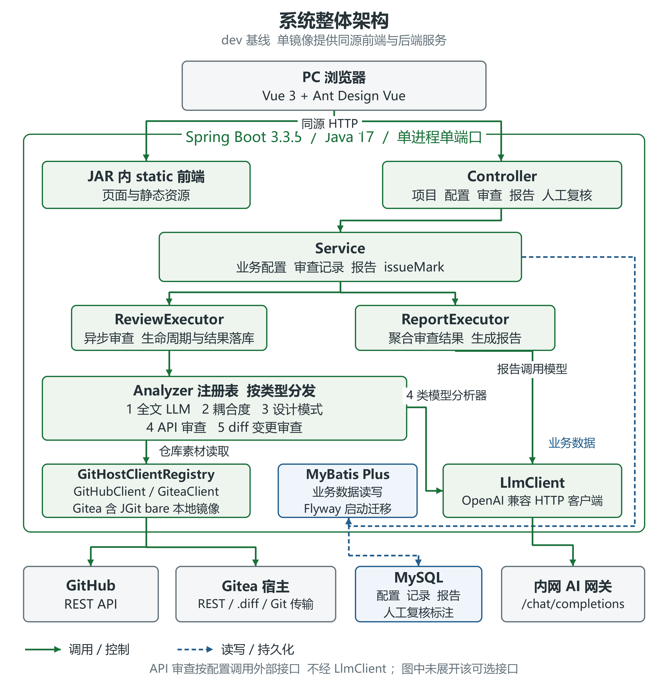
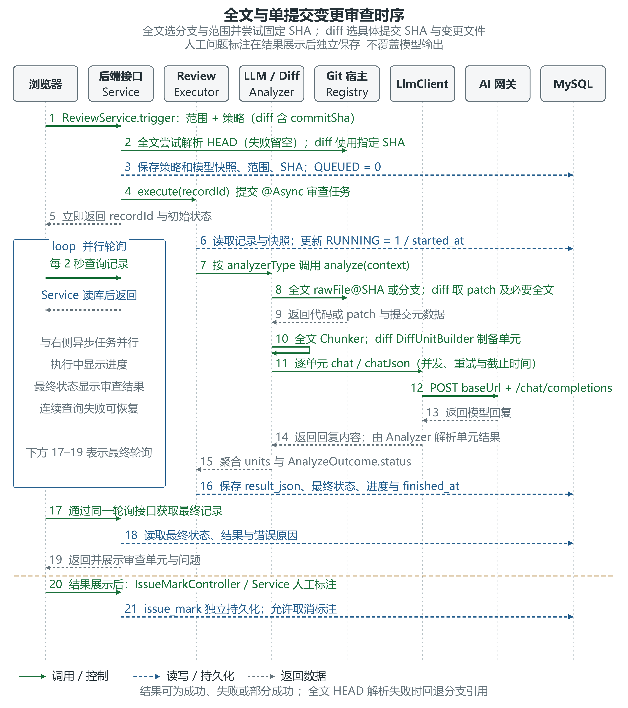

# aiCodeReview 技术报告

文档版本 1.0　编制日期 2026-10-13

适用分支 dev　源码基线 d114f622674c5de97196f8eab37c6933ee4da1cb

## 1 文档控制与交付结论

本系统通过代码仓库接入、确定性结构分析与大模型语义分析，支持文件审查、Java 耦合度分析、设计模式识别、外部 API 分析和单提交差异审查，并将审查记录汇总为 Markdown 报告。系统采用前后端资源一体打包的 Spring Boot 应用和独立 MySQL 容器，面向内网以离线镜像包部署。

本报告供技术评审、部署负责人和后续维护人员使用，说明技术路线、模块职责、模型设置、执行约束及测试证据。交付基线为 dev 的 d114f62，提交时间为 2026-09-21。本报告中的界面、分析器和部署流程均按该基线定义；后续版本应另行修订文档版本及基线。

| 项目 | 内容 |
| --- | --- |
| 文档名称 | aiCodeReview 技术报告 |
| 适用版本 | dev 分支 d114f62 |
| 编制日期 | 2026-10-13 Asia/Taipei |
| 交付形态 | Word 技术报告及可编辑系统图源 |
| 本次工程证据 | 后端 335 项中 326 通过 9 条件跳过；前端 347 项通过；类型检查与隔离构建通过 |
| 使用方确认 | 该分支已多次通过 GitHub Actions，并在内网完成部署验证 |

本地回归验证支持该基线已有行为的工程稳定性。使用方确认支持发布与部署路线具备实际运行基础；业务质量验收还需结合指定源码、模型结果、人工复核和现场原始记录。审查状态“成功”表示执行完成，不等同于代码没有缺陷或模型结论已经人工证实。

## 2 技术路线与能力范围

技术路线为“仓库输入制备 → 按策略选择分析器 → 确定性计算或模型调用 → 结果落库 → 人工复核与报告汇总”。Java 依赖指标由程序计算，模型负责语义问题识别、模式判断和解释建议。两类结果共同呈现，使指标计算过程可以复核，也保留模型分析所需的上下文。

| 层次 | 采用技术与作用 |
| --- | --- |
| 浏览器界面 | Vue 3、TypeScript、Vite、Ant Design Vue；Axios 调用 REST；ECharts 展示关系图；Markdown 与差异组件展示结果 |
| 服务端 | Java 17、Spring Boot 3.3.5、Spring MVC；业务服务负责配置、审查与报告；异步任务池执行分析 |
| 结构分析 | JavaParser 3.28.2，以 Java 17 语法级别抽取类型、显式 import、字段和方法签名 |
| Git 接入 | GitHub REST 与原文接口；Gitea REST 与 .diff；JGit 7.2 本地 bare 镜像辅助三点比较 |
| 模型接入 | Spring RestClient 调用 OpenAI 兼容 chat/completions；Bearer 令牌；JSON 或普通对话输出 |
| 数据层 | MySQL 8.0.36、MyBatis-Plus 3.5.7；Flyway V1 至 V7 管理数据库演进 |
| 构建与部署 | Node 22、pnpm 10.18.2、Maven 与 Java 17 三阶段 Docker 构建；JRE 17 jammy 运行；Linux amd64 离线包 |

五类策略的输入、方法与结果如下。策略编号是当前实现的分发键，不表示质量等级。

| 策略 | 主要方法 | 输出与适用范围 |
| --- | --- | --- |
| 1 llm-review | 获取所选文件原文，按阈值分块后调用模型；可选多文件合并 | 单元问题、摘要及原始文本；适合源码规则与业务语义审查 |
| 2 coupling | Java 结构抽取，计算类依赖与包级模块指标，再尽力生成模型建议 | 扇入扇出、强连通分量、模块 Ca Ce I 和建议 |
| 3 design-pattern | 将 Java 类型、字段、继承实现和方法签名摘要送入模型 | 固定十类设计模式、参与类、依据、置信度、误用判断和建议 |
| 4 api-review | POST 触发外部服务，按配置 GET 查询 issues，提供结果链接 | 外部问题或触发查询错误；基础 API 适配，不负责完整流水线生命周期 |
| 5 diff-review | 读取一个提交相对第一父提交的变更，制备方法或 hunk 单元 | 变更问题、新侧行号、提交意图判断与原始结果；最多 50 个实际单元 |

设计模式清单为单例、工厂、抽象工厂、建造者、观察者、策略、装饰器、适配器、代理和模板方法。系统没有覆盖全部 GoF 模式的承诺。提交视图每次选择一个提交；多个提交可逐次审查，再汇总已有记录。

<!-- pagebreak -->

## 3 系统架构



图T 01 按运行职责划分浏览器、应用、数据库、Git 宿主和模型网关。图中的调用关系表示设计路径，现场连通性需由部署验证记录确认。可选外部 API 路径与持久化路径分别标识，数据库为应用维护的逻辑关联。

Controller 提供统一 REST 入口，Service 校验并保存项目、策略、提示词版本和模型配置。ReviewExecutor 与 ReportExecutor 在记录级任务池中执行审查和报告任务。Analyzer 注册表按类型分发；文件 LLM 和 diff 分析器使用单元级任务池，耦合建议、模式识别和报告模型调用直接由记录任务执行。

GitHostClientRegistry 按仓库宿主选择客户端，未知宿主显式报错。GitHub 通过提交详情和 Contents API 读取材料，原文接口用于兜底。Gitea 1.16.1 的提交 patch 由 .diff 文本解析；缺少 compare 接口时，通过 JGit bare 镜像计算 merge-base 三点差异。应用持久卷保存该镜像，避免每次完整克隆。

Vue 构建资源进入后端 JAR 的 static 目录，页面和 API 由同一个应用端口提供。应用容器监听 8080，经宿主默认 18080 提供访问；MySQL 仅在 Compose 内部网络开放。运行配置以只读文件挂载，数据库数据与 Git 镜像分别持久化。

<!-- pagebreak -->

## 4 执行过程与状态



图T 02 描述两条输入入口及共同的记录生命周期。结构视图从分支和文件范围发起全文审查；提交视图从单个 commit SHA 和变更文件发起 diff 审查。材料制备由分析器内部完成，浏览器通过 API 轮询持久化状态，人工标记另行保存。

触发时，ReviewService 校验项目、策略和模型，保存分支、范围及策略模型提示词快照，并创建排队记录。llm-review、coupling 和 design-pattern 尽量将分支 HEAD 解析成 SHA，后续按固定 SHA 获取原文；解析失败时可能降级按分支名读取。api-review 不绑定源码 SHA；验收材料应按实际策略保留记录中的 SHA 与范围。

异步执行开始后写入 startedAt 和进度，分析器获取原文或 patch、制备单元、调用模型并聚合结果。文件 LLM 和 diff 按完成比例更新进度；结束时写入 resultJson、finishedAt 和终态。界面耗时从实际开始到完成，不包含排队时间。

| 状态值 | 界面含义与解释 |
| --- | --- |
| 0 | 排队中，任务尚未开始执行 |
| 1 | 执行中，应结合进度和错误查询判断 |
| 2 | 成功，分析过程完成；仍需复核模型意见与材料范围 |
| 3 | 失败，查单元或任务错误并修正依赖条件 |
| 4 | 部分成功，已有结果可读，但失败单元形成范围缺口 |

内存队列不是持久化调度系统。当前实现没有跨进程重启恢复排队或执行中任务的统一机制；运维重启前应确认在途任务，重启后核对尚未终止的记录，按需要重新发起。

## 5 AI 大模型设置方法

模型接入需要四项数据：配置名称、接口地址、Token 和模型名。名称用于选择配置；模型名必须是网关接受的请求标识；Token 为请求用令牌。创建或修改模型后会尝试连通验证，失败仍保留配置并呈现失败状态。修改 Token 留空保留原值，选中“清除 token”才删除。

接口地址应填写到实际接口根。客户端直接拼接 baseUrl 加 /chat/completions，不自动添加 /v1，也不去掉尾部斜杠。例如实际接口为 https://gateway.example/v1/chat/completions，应填 https://gateway.example/v1；实际接口没有 /v1 时则填相应根地址。示例地址仅用于说明路径，不是现场配置。

推荐接入顺序为：取得现场网关根地址和模型标识 → 在“模型”中新建 → 点击“验证” → 用一个小范围审查验证 JSON 与实际输出 → 在策略中选择该模型。验证按钮使用 max_tokens 为 1 的极简 ping，只证明该请求得到正常响应。首次启动从 YAML 建立的默认模型直接标为成功，仍应人工点击验证并执行实际小例。

| 参数 | 设置位置与当前行为 |
| --- | --- |
| baseUrl token modelName | 模型界面，持久化到 model_config；策略绑定 modelConfigId |
| deepseek.base-url api-key model | YAML 默认模型 seed；模型表已有记录时不自动覆盖 |
| temperature | 正式调用固定为 0，页面不可调；不保证多次结果语义相同 |
| response_format | JSON 调用传 json_object；普通调用不传；不是 JSON Schema 约束 |
| messages | 正式请求为 system 与 user；ping 仅发送 user 内容 |
| max_tokens | 仅 ping 设置为 1；正式审查与报告未设置；界面无该字段 |
| connect-timeout-ms | YAML，默认 10000 毫秒；非正值回退默认 |
| read-timeout-ms | YAML，默认 300000 毫秒；非正值回退默认 |

JSON 路径的请求结构如下，Authorization 使用 Bearer 令牌。图源和文档不保存真实令牌。

```json
{
  "model": "<现场模型标识>",
  "temperature": 0,
  "response_format": {"type": "json_object"},
  "messages": [
    {"role": "system", "content": "角色与格式要求"},
    {"role": "user", "content": "分析模板 关注点 输入材料"}
  ]
}
```

自定义提示词对不同策略有不同影响。文件 LLM、耦合和模式策略绑定非空提示词后，改用普通对话并保存自由文本；文件 LLM 的结构化 issues 可能为空。diff 的提示词作为固定 JSON 模板内的关注点，不替换输出协议。综合报告使用普通对话生成 Markdown。

正式 LlmClient 没有检查 finish_reason 和 usage，也未按模型能力执行完整 token 预算校验。接入验收应包含长输入、格式偏离和输出截断的样本；不得用 ping 成功推断这些能力已通过。

## 6 分析方法与输入边界

全文审查默认按文件生成单元。超过 chunk-max-chars 时优先按方法或构造器边界切分，失败时按行切分。默认阈值 140000 的单位是字符，不是 token；字符除以 3.5 只是近似估计。多文件合并会把材料放入一次调用，超过阈值直接失败，不再自动拆分。

diff 审查以第一父提交到当前提交为基线，merge 提交也按第一父提交。Java 尽量补全新侧方法体并按变更行窗口裁剪，无法制备时回退 hunk 或全文；默认窗口 60 行，内部最小 10 行。单个文件可能形成多个单元，超过 50 个实际单元会失败并要求分批。前端“预估单元数”实为可审查文件数，不能作为真实调用次数。

耦合度的边来自所选源码中非静态、非通配的显式 import，目标类也必须在当前抽取集合内。未使用 symbol-solver，结果不覆盖同包引用、反射、运行时注入和完整调用关系。只抽取顶层类型；Lombok 生成的方法与内部匿名类型不构成完整结构材料。原文或解析失败文件可能被跳过，因此“未发现循环”仅适用于成功制备的范围。

类级高耦合条件为 fanOut 大于策略 threshold，默认 10。循环采用 Tarjan 强连通分量，表示依赖图中的环而非证明运行时递归。包级模块按共同包根的下一段聚合：Ca 为依赖该模块的去重模块数，Ce 为该模块依赖的去重模块数，I = Ce / (Ca + Ce)，结果保留两位小数；无边时 I 为 0。模块高耦合条件固定为 Ce 大于 3 且 I 不小于 0.8，与类阈值分开解释。

设计模式识别主要依赖结构摘要，没有所有方法体的业务上下文。模型置信度为其输出值，不能当作经校准的概率。外部 API 分析支持触发与一次查询，未实现持续等待 SonarQube 等外部任务完成的统一轮询；应结合外部结果链接核对原始产物。

## 7 调度 数据与可靠性

| 参数或机制 | 当前配置与约束 |
| --- | --- |
| 记录级任务池 | core 2 max 4 queue 100；审查与报告共享 |
| 单元级任务池 | review.concurrency 默认 4；core 与 max 相同，queue 1000；用于全文与 diff 单元 |
| 自动重试 | retry-max 默认 3；初次加 3 次，最多 4 次调用；退避默认 1 2 4 秒 |
| 可重试错误 | 网络超时、网络访问错误、5xx、403、429；无令牌、401 和确定性解析错误不自动重试 |
| 任务预算 | task-timeout-minutes 默认 50；提交前协作检查，不是任务总耗时硬上限 |
| 报告聚合预算 | 最终 user prompt 默认 140000 字符；每条聚合材料默认 20000 字符 |
| 结果写入 | result_json 与报告正文 MEDIUMTEXT；错误原因 VARCHAR 1000 并有界截断 |

上述单元重试循环用于文件 LLM 和 diff；耦合建议、模式识别与报告没有同一套自动重试。已经提交的单元和重试循环不持续中断 deadline，队列等待也会增加总耗时，因此默认 50 分钟不能作为“审查加报告一小时必定完成”的证明。实际业务耗时需要在指定环境和指定样本上测量。

数据库包括 sys_user、prompt、prompt_version、model_config、review_strategy、project、review_record、report、report_record 和 issue_mark 十张应用表。主键由应用分配，Long 向浏览器序列化为字符串。多数业务对象采用逻辑删除；关联由服务维护，没有物理外键。Flyway V1 至 V7 保持已有迁移不可改写，通过后续迁移增加索引、时间字段和大文本容量。

结果超过 1 MiB 时告警而非自动截断。保存失败时尝试写入有界错误并结束执行态；数据库完全不可用时仍可能只能记录日志。报告对所选记录去重后聚合，材料过大时截断单条或停止纳入后续条目；原始记录仍在库中。正式报告应检查是否裁剪，并核对选择范围、SHA 和策略快照。

Git Caffeine 缓存默认提交详情 200 条、原文 500 条、写后 30 分钟过期。结构物料缓存没有 TTL 与容量配置，键缺少仓库、宿主和分支维度，应关注长时间多仓使用的材料隔离风险。报告取数投影没有 status，失败记录带非空旧结果时可能仍被纳入；当前 diff 聚合名称落到默认 llm-review 标签，复核应以 type 5 快照和 commit 字段为准。

本分支未提供登录角色和权限体系。模型与项目令牌在普通响应中隐藏，但服务没有实现 SQL 注释所述 AES 加解密，审查快照可能保存 apiKey。数据库、备份、运行配置及内网访问入口应使用现场既有的访问控制；接口响应隐藏不等于存储加密。

## 8 测试方法与本次结果

本次验证日期为 2026-10-13，以 d114f62 的 Git 跟踪源码建立独立目录执行，没有使用运行配置、真实密钥或线上数据。后端使用 Java 17.0.20.1 和本地 Maven 离线依赖执行完整测试；前端使用 Node 24.19.0 与本机已有依赖执行测试、类型检查和构建。发布 CI 的 Node 为 22；本次前端结果不是从网络重装依赖后的 CI 环境复现。

| 检查 | 本次结果 |
| --- | --- |
| 后端完整测试 | 335 项，326 通过，9 跳过，0 失败，0 错误；构建摘要 SUCCESS |
| 前端完整测试 | 39 个测试文件，347 项全部通过 |
| 前端类型检查 | 退出码 0，通过 |
| 前端隔离构建 | 通过；15.87 秒为此次构建过程耗时，不是业务处理性能 |
| 发布工作流核对 | 后端和前端测试均为出包前置任务；类型检查 continue-on-error，不阻断发布 |
| GitHub Actions 与内网部署 | 使用方确认此前已多次通过与部署成功；现场证据按图T 03 和图T 04 归档 |

后端跳过项为 AI 网关探针 2 项、真实 Gitea 集成 5 项、依赖外部样本根的 JavaParser 探针 1 项、结构摘要加模型探针 1 项。本次未提供真实密钥、Gitea 集成地址或样本根，条件跳过不计为通过。

| 验证目标 | 现有工程覆盖与解释 |
| --- | --- |
| 仓库与变更材料 | URL 和分支编码、宿主选择、diff 解析、缓存、JGit 镜像测试；桩响应不能替代真实宿主兼容验证 |
| 审查编排 | 范围过滤、分块、状态、deadline、重试、持久化失败收敛；不证明生产队列负载上限 |
| 模型与策略 | 令牌保留和清除、模型超时、策略参数、自定义提示词；无真实模型质量评分 |
| 数据库迁移 | 迁移文本契约检查；没有在本次真实 MySQL 执行迁移或恢复备份 |
| 报告与界面 | 聚合预算、报告选择和轮询、Markdown 清洗、分页、失败重试与结果显示；组件测试不替代现场完整操作 |

前端日志包含测试桩组件告警，构建有大于 500 kB 的 chunk 提示；均未导致此次检查失败。正式网络环境的页面加载耗时仍应现场测量。本次未运行 Docker 镜像构建、部署脚本自测、内网模型调用或性能负载试验，不能把源代码回归结果扩展为这些检查已通过。

<!-- screenshot: T03 | 图T 03 GitHub Actions 发布流程证据 | 在对应 dev 版本的 Actions run 页面截取源码 SHA 日期 后端测试 前端测试及离线包任务结果；同时登记 run URL 和包版本；避免只截一个绿色总状态。 -->

<!-- screenshot: T04 | 图T 04 内网部署与业务小例证据 | 在现场记录包版本 部署时间 app 和 mysql 健康状态；补充同版本真实仓库与模型的小范围审查结果及记录ID；遮蔽密码 Token 和敏感代码。健康状态只证明对应探针通过。 -->

## 9 历史实验分析

三项技术实验记录日期均为 2026-09-03，属于早期 experiment 分支验证，已保留在 dev 的 backend/docs。它们支持技术选择，样本与实现范围如下。

| 实验 | 样本与原记录结果 |
| --- | --- |
| AI 网关 | 公网探针，两项测试无失败；结构输出连续三次均为合法 JSON，但 issues 数为 6 2 6 |
| JavaParser | toy 项目 19 个 Java 文件，19 个解析成功，抽取 18 个类型 21 个方法 43 个字段；7 项测试无失败 |
| 结构摘要与 LLM | 同一 19 文件样本，摘要 125 行约 1.5k 字符；1 项测试无失败；记录了分层 模式 耦合观察和建议 |

AI 实验证明当时服务能够响应兼容对话与 JSON 模式。三次问题数不同，说明格式稳定不等于语义确定；该结果不构成当前内网网关、模型别名或缺陷识别准确率证据。JavaParser 实验证明所测 Java 17 样本可被抽取，不能推广成任意项目全部解析成功。

结构摘要实验说明在没有方法体的情况下，模型可以根据类型和签名提出设计观察，支持降低输入体积的路线。原报告认为部分耦合判断偏高，生产因此保留确定性指标。历史实验的六类模式含分层和 DTO VO 等概念，与当前生产固定十类模式不同；命名一致性观察应作为复核线索，不能直接宣布运行时缺陷。

三份历史报告没有完整 HTTP 延迟、整轮业务耗时、吞吐量或 P95 数值。本报告不将测试执行时间或单例 token 计数转换为性能达标结论。

## 10 结果质量与验收口径

人工标记含“误报”“已采纳”和撤销。总体准确率为问题总数减误报数，再除以问题总数；未标记问题暂按非误报处理。已复核准确率为已采纳数除以已标记数，复核覆盖率为已标记数除以问题总数。应三项一起阅读，覆盖率较低时总体准确率容易偏高。

当前统计只读取 units 数组中的 issues，不计入 coupling 的 suggestions、design-pattern 的 patterns 和 API 结果根级 issues。当前可定位的新侧 diff 行内问题提供复核按钮，历史记录为只读。人工采纳不是独立缺陷真值；系统未计算漏报、召回率或 F1，不能凭绿色 70% 门槛表示质量验收通过。

正式质量验收应固定源码 SHA、策略、提示词版本、模型标识、范围和输出，使用具有已知缺陷与正常样本的代表性集合。专家分别判断模型发现是否真实、已知缺陷是否漏报，以及建议是否可执行。报告应记录问题级判定依据、复核覆盖率和范围缺口，保留重复运行差异，不以执行成功替代判定。

| 验收方面 | 应归档证据 |
| --- | --- |
| 功能与追溯 | 五类实际策略结果；源码 SHA 范围 配置快照；提交与第一父提交关系 |
| 模型能力 | 真实网关 ping 和 JSON 小例；长输入与格式偏离；模型标识和错误记录 |
| 业务质量 | 专家真值与问题级复核；误报及漏报；材料缺失和截断情况 |
| 完整耗时 | 从发起到审查及报告完成的实际起止时间；含排队与失败重审的口径 |
| 数据与运维 | 真实迁移结果；备份恢复演练；回退后数据兼容与业务小例 |

使用方已确认本基线发布和内网部署成功。后续现场归档将这项确认与版本、时间、日志及截图关联，形成可复查的交付记录。应用回退仅切镜像，不自动恢复数据库；部署健康探针请求首页，不代表模型和 Git 功能都通过。

## 11 图件与来源索引

图T 01 为逻辑架构，图T 02 为文件与提交差异审查时序，图T 03 和图T 04 为现场证据留白。PNG 已嵌入 Word；等价 Mermaid 与 SVG 保存在同目录系统图源文件及 figures 子目录，修改图件时同步核对节点、箭头、图例和正文。

以下路径均相对本报告对应的 dev 仓库基线。技术判断应按该提交的源码复核，运行配置由部署负责人另行维护。

| 编号 | 主要依据 |
| --- | --- |
| T01 | backend/pom.xml；frontend/package.json；frontend/vite.config.ts；Dockerfile |
| T02 | .github/workflows/release.yml；deploy/docker-compose.yml；deploy/scripts/deploy.sh preflight.sh backup.sh rollback.sh |
| T03 | backend/src/main/java/com/codereview/service/ReviewService.java ReviewExecutor.java ReportExecutor.java ReportAggregationBuilder.java |
| T04 | 同一 Java 根的 analyzer 各分析器；chunk/Chunker.java；diff/DiffUnitBuilder.java |
| T05 | 同一 Java 根的 llm/LlmClient.java LlmProperties.java；config/AsyncConfig.java ReviewProperties.java ReportProperties.java DataInitializer.java |
| T06 | 同一 Java 根的 git/GitHostClientRegistry.java GiteaClient.java GiteaGitMirror.java GitCache.java；material/StructureExtractor.java DepGraph.java ModuleGraph.java MaterialCache.java |
| T07 | 同一 Java 根的 service/IssueMarkService.java ModelConfigService.java；backend/src/main/resources/db/migration/V1 至 V7；frontend/src/components/DiffReviewResult.vue AccuracyBar.vue |
| T08 | backend/src/test；frontend/src 下的 __tests__；本次验证记录 validation.json |
| T09 | backend/docs/AI网关实验报告.md JavaParser实验报告.md 结构摘要LLM解读实验报告.md |
