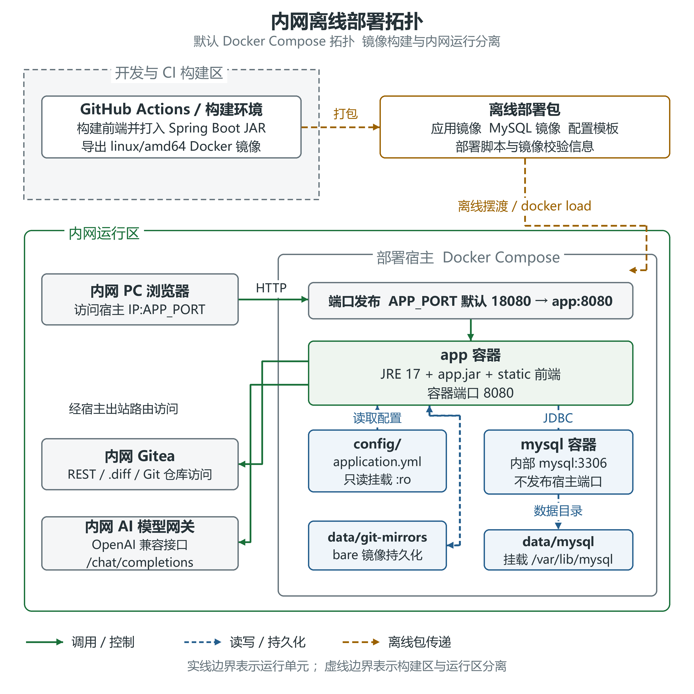

# 基于AI的智能代码分析工具 用户手册

文档版本 1.0　编制日期 2026-10-13

## 目录

- [术语表](#glossary)

- [文档信息](#document-info)

- [1 系统使用概览](#chapter1)

- [2 部署环境与网络说明](#chapter2)

- [3 离线部署包与首次部署](#chapter3)

- [4 运行维护、升级与回退](#chapter4)

- [5 AI 大模型接入与验证](#chapter5)

- [6 提示词管理](#chapter6)

- [7 审查策略配置](#chapter7)

- [8 项目接入和范围准备](#chapter8)

- [9 结构视图审查](#chapter9)

- [10 单次提交与多个提交审查](#chapter10)

- [11 审查结果、人工复核与准确率](#chapter11)

- [12 历史记录查看与报告生成](#chapter12)

- [13 常见故障与交付留存](#chapter13)

- [14 图件清单](#chapter14)

<a id="glossary"></a>

## 术语表

本表解释正文中反复出现的概念。可先阅读，也可在遇到陌生术语时返回查阅。

| 术语 | 通俗说明 |
| --- | --- |
| 代码仓库 / Git / Gitea | 代码仓库集中保存项目文件及修改历史。Git 负责记录版本；Gitea 是通过网页管理 Git 仓库的服务，便于浏览代码和协作。 |
| 分支 branch | 同一项目的一条开发路线。不同分支可以分别开发和维护；分支名称不代表固定版本，继续提交后它指向的代码会变化。 |
| 提交 commit / SHA | 一次被 Git 保存的代码修改记录。SHA 是这次提交的编号，用它可以定位同一份代码版本；短 SHA 是完整编号的缩写。 |
| 差异 `diff` / 第一父提交 | `diff` 列出两个版本增加、删除或修改的内容。第一父提交是当前提交的第一个直接前序版本；合并提交还可能有其他父提交。 |
| 审查策略 / 分析器 | 策略是选好的分析方式、模型和参数组合；分析器是实际执行该类分析的程序。可以把它们理解为「检查方案」和「执行检查的工具」。 |
| 大模型 LLM / 模型名 | 大模型根据代码和要求生成分析意见。模型名是发送给网关的调用标识，必须与现场提供的名称一致；模型意见仍需人工复核。 |
| 提示词 Prompt | 发给模型的任务说明，例如检查重点、业务规则和回答格式。提示词不是待审查的代码，它用于告诉模型应怎样分析代码。 |
| AI 网关 / API 接口 | 接口是程序之间发送请求、接收结果的约定入口。AI 网关提供模型调用入口；系统向它发送模型名、提示词和代码材料，再读取回答。 |
| Token 认证令牌 | 调用网关或仓库时用来证明调用权限的凭据，作用类似钥匙。它不是模型名，也不是密码示例；保存配置和截图时需要保护它。 |
| 字符 / 模型 `token` | 字符是文本中的字、字母或符号；模型 `token` 是模型切分文本后使用的计量单位，二者没有固定换算比例。这里的 `token` 与认证令牌含义不同。 |
| JSON | 一种按字段组织数据的文本格式，便于程序读取。例如 `issues` 保存问题列表，summary 保存摘要；它与供人阅读的普通说明文字用途不同。 |
| Markdown | 用简单标记表示标题、列表和表格的文本格式，文件通常以 `.md` 结尾。本系统生成的报告使用这种格式，可以查看、保存和继续编辑。 |
| 配置快照 | 任务发起时保留的一份配置副本，用来说明当时采用的策略、模型和提示词。以后修改当前配置，不会自动改写这份历史副本。 |
| Docker / 镜像 / 容器 | Docker 用于运行打包好的应用。镜像是准备好的程序与运行环境；容器是镜像启动后的运行实例，可以把它们理解为「安装包」和「正在运行的程序」。 |
| Docker Compose | 按配置文件一起管理应用、数据库、网络和挂载目录的工具。手册中的 `docker compose` 命令用于启动、检查或停止这一组服务。 |
| 离线部署包 | 事先准备好的镜像、脚本和配置文件集合，复制到目标机后即可装载部署。部署时不必从公网下载镜像；运行时仍需连接现场仓库和 AI 网关。 |
| `.env` / YAML 配置 | 用于保存运行参数的文本文件。`.env` 常按「名称=值」填写；YAML 按缩进组织配置。空格、引号和缩进会影响读取，修改时需遵守手册示例。 |
| MySQL / 持久化 | MySQL 是保存配置、审查记录和报告的数据库。持久化是把数据保存到数据库或磁盘，使它不只留在程序内存中；它不等同于备份。 |
| 备份 / 回退 | 备份是另外保存一份数据以便恢复；回退是切回较早的应用版本。应用镜像回退不会自动恢复数据库数据，数据恢复还需单独处理。 |
| 异步任务 / 任务池 / 队列 | 异步任务在后台执行，用户发起后可继续操作。任务池安排若干线程处理工作；队列存放等待处理的任务。进入队列不代表任务已经完成。 |
| 重试 / 超时 | 重试是在符合条件的失败后再次尝试请求；超时是等待或执行时间超过设定范围。二者用于处理异常，不代表一定能完成或得到正确分析结论。 |
| 耦合度 `coupling` | 描述代码之间相互依赖的程度。一个类或模块依赖较多，修改时可能影响更多地方；指标用于帮助定位复核重点，不能单独证明代码有缺陷。 |
| 设计模式 design pattern | 解决常见软件设计问题的一类组织方法，例如工厂模式、观察者模式。识别结果说明代码可能采用了哪种方法，还需要结合实际代码判断是否合适。 |
| 误报 / 已采纳 | 误报表示复核人员认为这条发现不成立；已采纳表示接受这条分析意见。标记帮助记录人工判断，「已采纳」本身不表示代码已经修复。 |
| 准确率 / 复核覆盖率 | 准确率汇总问题标记中的判断结果；复核覆盖率表示有多少问题已经人工标记。二者需一起看，不能把大量未复核的问题当作已经确认正确。 |

<a id="document-info"></a>

## 文档信息

| 文档属性 | 内容 |
| --- | --- |
| 系统名称 | 基于AI的智能代码分析工具 |
| 文档版本 | 1.0 |
| 适用分支 | dev |
| 适用源码基线 | d114f62 |
| 编制日期 | 2026-10-13 |
| 适用人员 | 部署负责人、系统运维人员、代码审查人员、项目负责人 |

本手册说明 dev 基线的离线部署、模型和仓库接入、代码审查、人工复核及报告生成操作。应用界面或部署包升级后，应按对应版本核对本手册；其他分支的页面、配置和功能不在本手册适用范围内。

本手册中的 `<版本>`、`<目标机内网IP>`、`<网关主机>` 和 `<owner>/<repo>` 为现场填写项。命令示例使用 Linux 终端；界面操作使用部署后的浏览器页面。所有示例均不包含真实密码或令牌。

长命令、定时任务和配置值可能因版面宽度自动折行。抄写或粘贴时，每条命令和每个配置值应保持为一行；不要在自动折行处插入回车。`.env` 中的 `JAVA_OPTS` 需保留整段双引号。

<a id="chapter1"></a>

## 1 系统使用概览

### 1.1 系统用途

基于AI的智能代码分析工具结合 Git 仓库材料与可复用审查策略，支持全文代码审查、Java 耦合度分析、设计模式识别、外部 API 审查和单次提交变更审查。使用人员可保存审查记录、复核部分结构化问题，并将多条已完成记录汇总为综合报告。

使用时应同时检查审查范围、执行状态和分析意见。分析执行成功表示本次任务完成，不表示代码没有缺陷，也不表示模型意见已经由人员确认。正式结论应由审查人员结合源码、变更目的与业务约束复核。

### 1.2 页面入口

默认访问地址为：

```text
http://<目标机内网IP>:18080
```

**操作前提**：已完成部署，并取得实际访问地址。部署负责人修改应用端口后，应使用修改后的地址。

1. 在浏览器中打开访问地址。
2. 从左侧导航选择「项目」「模型」「策略」或「提示词」。
3. 在项目列表中点击项目名称，进入项目详情。

**预期结果**：项目详情包含「代码审查」「审查记录」「报告生成」三个页签；「代码审查」包含「结构视图」和「提交视图」。页面无法访问时，按第 13.1 节处理。

| 页面 | 主要操作 |
| --- | --- |
| 项目 | 接入仓库、进入项目详情、查看删除影响范围 |
| 模型 | 维护 AI 网关地址、Token、模型名，执行连通验证 |
| 策略 | 选择分析器并绑定模型、提示词或外部 API 参数 |
| 提示词 | 编写规则、保存版本、比较版本差异 |
| 项目详情 → 代码审查 | 选分支、文件范围或单次提交，发起任务、查看当前结果 |
| 项目详情 → 审查记录 | 查看历史记录、耗时、准确率汇总和重审入口 |
| 项目详情 → 报告生成 | 勾选已完成记录、生成并下载 Markdown 报告 |

当前版本没有登录页面或内建用户角色管理入口。部署负责人应通过内网访问范围、主机访问策略或所在环境的统一访问控制保护入口。

### 1.3 首次使用顺序

建议按以下顺序完成首次使用。部署、模型接入、策略配置和项目接入的具体前提与操作见对应章节：

1. 部署离线包，确认服务状态和页面访问。

2. 在「模型」页面接入并验证现场 AI 网关。

3. 按业务需要在「提示词」页面编写规则。

4. 在「策略」页面选择分析器，绑定模型及可选提示词。

5. 在「项目」页面接入实际仓库。

6. 进入项目详情，明确分支和审查范围，执行一次小范围审查。

7. 复核结果，检查范围缺口，保留审查记录。

8. 在「报告生成」页签勾选相关记录，生成、审阅并下载报告。

截图采集说明  采集部署后的项目列表，完整显示左侧项目、模型、策略、提示词四个菜单及项目名称入口；使用可公开的项目名，遮蔽不需公开的仓库地址和浏览器内部地址。

> 此处预留现场截图，约 6 厘米高，按前文采集说明补入。

图U 01 系统导航与项目入口  现场截图预留

<a id="chapter2"></a>

## 2 部署环境与网络说明

### 2.1 部署形态

正式交付使用 Linux amd64 离线 Docker 部署包。应用镜像内包含 JRE 17、Spring Boot 后端和已构建的 Vue 前端；应用以单容器、单业务端口提供页面及后端接口。数据库使用单独的 MySQL 8.0.36 容器。

目标机运行离线包时，无需另行安装 Node.js、pnpm、Maven、JDK 或 Nginx。离线镜像装载不依赖公网镜像仓库；业务运行仍需连通现场 Git 服务和 AI 网关。



图U 00 内网离线部署拓扑

图U 00 说明：浏览器通过宿主机应用端口访问应用容器；应用通过内部 Docker 网络访问 MySQL，通过 HTTP(S) 访问 Git 服务和 AI 网关。数据库目录、Git 镜像缓存和运行配置由宿主机持久化。外部流水线和 SonarQube 连接用于可选的 `api-review` 策略。

### 2.2 环境要求

| 项目 | 要求或默认参数 | 部署说明 |
| --- | --- | --- |
| 处理器架构 | Linux amd64 | 离线发布镜像固定为 linux/amd64 |
| 历史验证环境 | CentOS 7.6.1810；内核 3.10.0-957.el7.x86_64 | 仓库部署资料记录的目标环境，不代表其他系统已完成同等验证 |
| 历史 Docker / Compose | Docker 20.10.24；Compose v2.17.2 | 优先使用 `docker compose`；脚本也支持独立 `docker-compose` |
| 部署目录文件系统 | Linux 原生文件系统 | 避免 WSL 的 `/mnt/c`、`/mnt/h` 及 NTFS、CIFS 等共享挂载点 |
| 部署分区可用空间 | 至少 5 GB | 前置体检检查；还需为代码镜像、业务数据和备份增长预留空间 |
| Docker 数据分区可用空间 | 至少 8 GB | 前置体检检查实际 `DockerRootDir` 所在分区 |
| 当前可用内存 | 至少 6 GB | 前置体检要求，不是主机总内存要求 |
| 应用容器内存限制 | `4g` | 默认配置值，需结合实际负载评估 |
| MySQL 容器内存限制 | `2g` | 默认 buffer pool 为 `1G` |
| JVM 堆参数 | `-Xms1g -Xmx4g` | 调整时同时考虑容器内非堆和其他运行开销 |
| 应用容器内端口 | 8080 | 由应用镜像使用 |
| 宿主机访问端口 | 18080 | 可通过 `APP_PORT` 修改 |
| 数据库端口 | 内部 `mysql:3306` | 默认不向宿主机发布 |
| Compose 项目名 | `codereview` | 用于管理本系统服务 |
| Docker 网络名 | `codereview-net` | `bridge` 网络，部署脚本尝试避开其他项目网段 |

**部署前提**：Docker 守护进程可访问，部署账号具有相应操作权限；目标机具备 `Bash`、`tar`、`gzip`、`sha256sum`、`sed`、`awk` 等部署工具。

环境采集脚本可列出工具和资源现状。关键资源或端口条件不满足时，前置体检会阻止部署。

应用和数据库的 `4g`、`2g` 是容器限制配置，不能作为实测峰值或主机新增总资源占用的证明。现场应保留其他业务所需资源，并持续观察磁盘和内存。

### 2.3 网络与端口

| 方向 | 连接内容 | 现场要求 |
| --- | --- | --- |
| 浏览器 → 应用 | `APP_BIND_IP:APP_PORT`，默认 `0.0.0.0:18080` | 用户所在内网可访问该端口 |
| 应用 → MySQL | Docker 网络中的 `mysql:3306` | 无需开放宿主机 3306 |
| 应用 → Gitea | 仓库 HTTP(S)、API 和本地镜像同步 | 仓库地址与宿主配置正确，令牌具有读取权限 |
| 应用 → AI 网关 | OpenAI 兼容 chat/completions 接口 | 网关可达，Token 和模型名有效 |
| 应用 → 外部流水线 | `api-review` 的调用 API、可选查询地址 | 仅使用该策略时需要 |
| 浏览器 → SonarQube | 结果展示地址 | 使用 `api-review` 的外部结果链接时需要 |

`APP_BIND_IP` 的默认配置监听所有网卡。仅向指定内网网卡提供访问时，可填写该网卡地址。防火墙和访问范围由部署负责人按现场制度配置；部署脚本不会自动开放防火墙，也不会重启 Docker 守护进程。

<a id="chapter3"></a>

## 3 离线部署包与首次部署

### 3.1 包名和目录

离线包命名为 `codereview-offline-<版本>.tar.gz`。它包含应用镜像、MySQL 镜像、部署脚本、配置模板、源码快照和校验和。

```text
codereview-offline-<版本>/
├─ docker-compose.yml
├─ .env.example
├─ config/application.yml.example
├─ images/
│  ├─ codereview-app-<版本>.tar.gz
│  ├─ mysql-8.0.36.tar.gz
│  └─ SHA256SUMS.txt
├─ scripts/
│  ├─ deploy.sh
│  ├─ preflight.sh
│  ├─ backup.sh
│  ├─ rollback.sh
│  └─ common.sh
├─ env-check.sh
└─ source-<版本>.zip
```

首次部署后还会建立以下运行文件和目录：

| 位置 | 用途 | 保存要求 |
| --- | --- | --- |
| `.env` | 数据库密码、镜像版本、端口及环境令牌 | 含凭据，与数据库数据配套保存 |
| `config/application.yml` | 渲染后的运行配置 | 包含数据库连接等现场配置，应保护并备份 |
| `data/mysql` | MySQL 持久化数据 | 不得随意删除或覆盖 |
| `data/git-mirrors` | Gitea 本地 bare 仓库缓存 | 需要应用容器可写；可重建，但重建需要重新同步仓库 |
| `backups` | 数据库 SQL `gzip` 和 `.env` 副本 | 限制访问并按要求异地留存 |

### 3.2 解压与环境采集

**操作前提**：已取得离线包，目标目录位于 Linux 原生文件系统。

**操作步骤**：将离线包复制到目标目录，再依次解压、进入包根目录并运行环境采集脚本：

```text
tar xzf codereview-offline-<版本>.tar.gz
cd codereview-offline-<版本>
bash env-check.sh
```

**预期结果**：脚本读取系统、Docker、资源、网络和工具信息，生成报告；默认写入 `/tmp`，终端显示实际报告路径。需要保存到其他可写交付目录时，可以指定目录：

```text
bash env-check.sh /<可写报告目录>
```

环境报告可能包含内部主机名、IP 和环境信息；提供给其他人员前，应按要求脱敏。

### 3.3 校验镜像完整性

**操作前提**：已解压离线包，当前位于包根目录。

**操作步骤**：执行以下镜像校验命令：

```text
cd images
sha256sum -c SHA256SUMS.txt
cd ..
```

**预期结果**：应用镜像和数据库镜像均显示 `OK`。

**失败处理**：出现 `FAILED` 时停止部署。重新获取或复制正确文件，校验通过后再继续。

### 3.4 设置部署参数

**操作前提与限制**：

- 手工建立 `.env` 时，必须填写两个数据库密码。脚本不会自动补齐手工文件中的空密码。
- 本版本通过文本替换生成运行 YAML。手工密码应使用至少 24 位随机字母和数字，不添加引号；包含 &、|、反斜杠或 YAML 特殊内容的值可能破坏替换或配置解析。现场口令策略要求特殊字符时，应由部署负责人校验并手工设置运行配置后再启动。
- 数据库密码仅在 `data/mysql` 首次初始化时生效。已有数据库不会因 `.env` 修改而自动同步密码；确需修改时，应由数据库管理员同步处理数据库账户和应用连接配置。

#### 3.4.1 手工建立部署参数文件

推荐先复制参数模板，再填写现场值。命令如下：

```text
cp .env.example .env
vi .env
```

| 参数 | 默认值或填写要求 |
| --- | --- |
| `APP_PORT` | 18080；修改为现场允许且空闲的端口 |
| `APP_BIND_IP` | `0.0.0.0`；可改为指定内网网卡 IP |
| `MYSQL_ROOT_PASSWORD` | 手工建立 `.env` 时必须填写 |
| `MYSQL_PASSWORD` | 手工建立 `.env` 时必须填写 |
| `MYSQL_DATABASE` | code_review |
| `MYSQL_USER` | `codereview` |
| `MYSQL_IMAGE_TAG` | 8.0.36 |
| `APP_MEM_LIMIT` / `MYSQL_MEM_LIMIT` | `4g` / `2g` |
| `JAVA_OPTS` | 含空格的整段值应保留双引号 |
| `GITEA_TOKEN` / `GITHUB_TOKEN` | 可选仓库认证备用令牌 |
| `DEEPSEEK_API_KEY` | 默认模型初始化使用的网关令牌；也可随后在模型界面配置 |
| `AI_BASE_URL` | 现场 AI 网关接口根地址，填写方法见第 5 章 |
| `AI_MODEL` | 现场模型的准确名称 |

以下为说明性参数片段，不应整段覆盖现有 `.env`。使用前必须替换尖括号占位内容：

```text
APP_PORT=18080
APP_BIND_IP=0.0.0.0
MYSQL_DATABASE=code_review
MYSQL_USER=codereview
MYSQL_ROOT_PASSWORD=<现场设置的数据库root密码>
MYSQL_PASSWORD=<现场设置的应用数据库密码>
AI_BASE_URL=https://<网关主机>/v1
AI_MODEL=<网关提供的模型名>
DEEPSEEK_API_KEY=<现场网关令牌>
JAVA_OPTS="-Xms1g -Xmx4g -XX:+UseG1GC -XX:-UseTransparentHugePages -Dfile.encoding=UTF-8 -Duser.timezone=Asia/Shanghai"
```

**预期结果**：`.env` 已填写现场参数；手工建立文件时，两个数据库密码均有值，`JAVA_OPTS` 中含空格的整段值保留双引号。

#### 3.4.2 由脚本自动初始化

首次初始化时，也可不提前建立 `.env`，直接执行第 3.5 节的部署脚本。仅当 `.env` 不存在时，脚本才会从模板创建文件并生成两个随机数据库密码。

### 3.5 执行部署

**操作前提**：已完成环境采集、镜像校验和部署参数选择。

**凭据保护**：首次自动生成密码时，结束输出可能显示应用数据库密码。应及时保存到受控凭据管理位置，截图中不得包含该行。

**执行前须知**：脚本在启动确认之前，就可能生成文件、装载镜像、修改镜像标签或备份。取消启动不表示脚本尚未写入任何内容。已有数据库备份失败时，脚本会警告并继续；升级前应人工确认备份成功。

**操作步骤**：

1. 在离线包根目录执行部署脚本：

```text
bash scripts/deploy.sh --tag <版本>
```

脚本随后建立目录、调整 Git 缓存权限、生成缺失配置、执行前置体检、装载本地镜像、设置应用版本、尝试备份已有数据库并配置网络。

2. 出现启动确认提示后，核对应用端口、内存限制和项目名。
3. 核对后输入 `y`，确认启动。

**预期结果**：应用启动后，脚本最多等待约 5 分钟检查健康状态；成功时打印访问地址。之后按第 3.7 节检查业务功能。

**失败处理**：启动或健康检查失败时，按第 13.1 节处理。

### 3.6 设置 Gitea 接入

**操作前提**：已取得现场 Gitea 主机信息，并可修改运行配置。

1. 在 `config/application.yml` 的 `git.gitea.hosts` 中加入现场 Gitea 主机。
2. 按 `host[:port]` 填写条目，不包含协议和路径。配置片段如下：

```text
git:
  gitea:
    hosts:
      - <Gitea主机或主机:端口>
    api-base: ""
    token: ${GITEA_TOKEN:}
    local-clone-enabled: true
    work-dir: /app/data/git-mirrors
    mirror-timeout-seconds: 120
    diff-max-bytes: 5242880
```

HTTP(S) 仓库 URL 示例为 `http://<Gitea主机>/gitea/<owner>/<repo>`。系统保留 `/gitea` 等站点前缀，推导 API 根为 `http://<Gitea主机>/gitea/api/v1`。通常保持 `api-base` 为空；使用 `git@host:owner/repo` 地址时，因地址没有 HTTP 前缀，须显式设置包含 `/api/v1` 的 API 根。使用人员优先填写 HTTP(S) 仓库 URL。

`local-clone-enabled` 和持久化镜像目录用于支持 Gitea 缺少 compare 接口时的本地差异计算。模板中的同步超时单位是秒，默认 120；`diff` 限制单位是字节，默认 5242880，即 5 MiB。

3. 修改运行 YAML 后，执行以下命令重启应用：

```text
docker compose -p codereview --env-file .env -f docker-compose.yml restart app
```

### 3.7 部署完成检查

**操作前提**：部署脚本已完成启动和健康检查。

部署负责人应依次检查以下结果，并记录实际版本和时间：

1. 镜像校验通过，版本符合交付要求。

2. 查看 Compose 状态，确认应用和数据库运行及健康状态。

3. 浏览器打开实际访问地址，确认页面显示。

4. 在「模型」页面执行验证。

5. 接入一项仓库，确认分支、文件树和提交列表可读取。

6. 执行一条小范围审查，确认结果和记录能够显示。

**结果判断**：应用容器健康检查只访问 / 页面。页面有响应不能替代模型、仓库和完整业务流程检查；上述检查未通过时，应按第 13.1 节定位对应故障。

截图采集说明  采集镜像校验 `OK`、前置体检关键资源检查及 Compose ps 中的 app 和 mysql健康状态，可合并为子图；标明部署版本与采集时间，遮蔽密码、令牌、内部主机身份等敏感内容，禁止截入首次密码输出行。

> 此处预留现场截图，约 6 厘米高，按前文采集说明补入。

图U 02 部署检查与服务状态  现场截图预留

<a id="chapter4"></a>

## 4 运行维护、升级与回退

### 4.1 常用维护命令

**执行前提**：当前目录为实际部署包根目录，部署账号具有相应 Docker 操作权限。

Compose 服务名为 app 和 mysql；固定容器名为 `codereview-app` 和 `codereview-mysql`。`logs`、`restart` 等 Compose 服务操作使用服务名。

```text
# 服务状态
docker compose -p codereview --env-file .env -f docker-compose.yml ps
```

```text
# 应用最近200行日志
docker compose -p codereview --env-file .env -f docker-compose.yml logs --tail=200 app
```

```text
# 数据库最近200行日志
docker compose -p codereview --env-file .env -f docker-compose.yml logs --tail=200 mysql
```

```text
# 实时应用日志，按 Ctrl+C 结束查看
docker compose -p codereview --env-file .env -f docker-compose.yml logs -f app
```

```text
# 停止已有服务
docker compose -p codereview --env-file .env -f docker-compose.yml stop
```

```text
# 启动已有服务
docker compose -p codereview --env-file .env -f docker-compose.yml start
```

```text
# 运行YAML更新后重启应用
docker compose -p codereview --env-file .env -f docker-compose.yml restart app
```

修改 `.env` 中端口、环境令牌或 JVM 环境参数后，单纯 `restart` 不会重新创建容器环境。核对配置后可重新执行部署脚本，使 Compose 应用变更。修改模型界面中的配置则保存到数据库，按界面保存并验证即可。

### 4.2 数据库备份

**操作前提**：MySQL 状态为 `healthy`，`.env` 中的 `root` 密码有效。

**执行前须知**：每次备份运行都会清理超过 7 天的本项目 SQL 和 `env` 副本。

**操作步骤**：在实际部署包根目录执行手工备份：

```text
bash scripts/backup.sh
```

**预期结果**：脚本使用事务一致性导出选项生成压缩 SQL，并保存当时的 `.env` 副本。备份内容和位置如下：

| 备份内容 | 位置 | 说明 |
| --- | --- | --- |
| 数据库 SQL | `backups/<数据库名>-<时间>.sql.gz` | 包含例程、触发器和事件 |
| 部署凭据副本 | `backups/env-<时间>.txt` | 含密码，应限制访问 |
| 运行配置 | `config/application.yml` | 备份脚本未自动复制，应纳入运维备份范围 |

脚本不会自动创建每日备份任务。需要每日备份时，由运维在实际部署目录配置定时任务，例如：

```text
0 2 * * * cd /opt/codereview-offline-<版本> && bash scripts/backup.sh >> backups/backup.log 2>&1
```

**结果核对**：确认备份文件非空，保留执行记录，并安排恢复验证。运行中直接复制 `data/mysql` 目录，不能替代已验证一致性的数据库备份，也不能据此认定备份成功。

### 4.3 应用升级

**操作前提**：独立完成一次备份，确认能够取得对应凭据和运行配置。

**操作步骤**：

1. 按交付说明，将更新包的镜像、脚本、Compose 与模板更新到受控部署目录。
2. 保留既有 `.env`、`config/application.yml`、`data/` 和 `backups/`。
3. 逐项核对新模板参数与既有运行配置，不直接用模板覆盖现场配置。
4. 执行部署脚本：

```text
bash scripts/deploy.sh --tag <新版本>
```

**预期结果与核对**：部署成功后，重新完成第 3.7 节的业务检查。

`config/application.yml` 只在文件不存在时首次渲染。后续修改 `.env` 中的 `AI_BASE_URL`，不会自动覆盖既有运行 YAML；通过界面保存的模型也不会因 YAML 修改而自动更新，应在「模型」页面处理。

### 4.4 应用镜像回退

**操作前提**：本机存在 `codereview-app:previous` 镜像。首次部署没有上一镜像时，无此回退目标。

**回退限制**：

- `previous` 来自部署时已有的 `latest` 镜像标签。人工修改标签或前一次启动失败，可能影响 `previous` 的实际指向。运维应记录版本对应关系，不能只凭标签名称推定它是最近成功版本。
- 应用镜像回退不恢复数据库数据，也不回退 Flyway 数据库迁移。需要恢复数据时，应由数据库管理员根据 SQL 备份、凭据和版本兼容性执行恢复并验证。当前部署包没有专门的数据恢复脚本，`rollback.sh` 不能作为数据库恢复操作。

**操作步骤**：在实际部署包根目录执行手工回退命令：

```text
bash scripts/rollback.sh
```

脚本会尝试备份数据库；提示确认后，将 `APP_TAG` 改为 `previous`，再启动服务并检查健康状态。

**结果判断**：回退后仍不健康时，保留状态与日志，由运维按第 13.1 节核对镜像版本、运行配置和数据库兼容性。

部署健康检查失败时，如果 `previous` 存在，部署脚本也会尝试自动回退。

### 4.5 凭据和交付资料保护

`.env`、运行 YAML、备份凭据副本和数据库包含敏感信息。模型和 API Token 在浏览器接口中采取只写不回读方式，不能据此认为数据库内凭据已经加密。

运维应限制部署目录与备份访问，保护代码和审查结果。排障截图不应显示 Token、数据库密码或可直接复用的认证值；对外提供配置时应先脱敏。删除项目之前，应保存需要留存的审查结果和报告。

<a id="chapter5"></a>

## 5 AI 大模型接入与验证

### 5.1 新建模型

**操作前提**：已取得现场网关接口根地址、认证令牌和准确模型名。

**操作步骤**：

1. 点击左侧「模型」，进入「模型接入」页面。
2. 点击「新建模型」。
3. 按下表填写字段，再保存配置。

| 字段 | 填写方法 |
| --- | --- |
| 名称 | 供策略和报告选择的显示名；必填，未删除模型中不得重复 |
| 接口地址 | 能够在后面直接拼接 `/chat/completions` 的接口根地址 |
| Token | 网关提供的调用令牌；本版本以 Bearer 认证调用 |
| 模型名 | 现场网关实际提供的准确名称 |

**预期结果**：保存新建或编辑配置时，系统执行连通验证。列表还提供「验证」「编辑」「删除」操作。

**失败处理**：验证失败时，配置仍以「验证失败」状态保留，页面显示失败原因。按第 5.4 节检查，调整配置后再次验证。

### 5.2 接口地址填写方法

本版本实际请求地址为：

```text
<接口地址>/chat/completions
```

| 网关实际完整接口 | 应填写的「接口地址」 |
| --- | --- |
| `https://<网关主机>/v1/chat/completions` | `https://<网关主机>/v1` |
| `https://<网关主机>/chat/completions` | `https://<网关主机>` |
| `https://<网关主机>/<服务前缀>/v1/chat/completions` | `https://<网关主机>/<服务前缀>/v1` |

不要填写完整的 `.../chat/completions`，也不要保留末尾斜杠。代码直接拼接路径；重复后缀或双斜杠可能导致网关路由失败。是否需要 `/v1` 应以现场网关实际接口为准。

### 5.3 Token 编辑行为

已经设置的 Token 不回填明文。编辑时显示「••••••••（已配置，留空不修改）」。保存前，根据需要选择以下一种处理方式：

- 保留原 Token：留空保存。
- 替换原 Token：输入新 Token。
- 删除原 Token：勾选「清除 `token`」。

本版本模型调用不接受空 Token。清除后应重新填写有效令牌再验证。截图保留隐藏状态即可，不需要展示真实值。

### 5.4 验证结果与验证范围

**操作步骤**：在模型列表点击「验证」，查看返回状态和失败原因。列表状态包括「未验证」「验证成功」「验证失败」。

**预期结果**：「验证」发送使用 `max_tokens: 1` 的极简 ping 请求，检查当前调用是否得到成功 HTTP 响应。

该验证不检查长代码上下文能力、JSON 输出能力或分析意见正确率。通过 ping 后仍应执行一条真实小范围审查。数据库尚无模型时，应用会从运行配置生成「DeepSeek(默认)」；此初始化记录虽显示成功状态，但没有实际发起 ping，首次部署也应主动点击「验证」。

**失败处理**：

| 现象 | 检查与处理 |
| --- | --- |
| 401/403 | 检查令牌及授权 |
| 404 | 检查接口根和 `/v1` 前缀 |
| 模型相关错误 | 核对现场网关提供的模型名 |
| 网络或读取超时 | 检查网关状态，以及应用到网关的网络可达性 |

### 5.5 超时和调用参数

以下设置属于运行 YAML，由部署负责人修改；不是模型表单字段：

```text
deepseek:
  connect-timeout-ms: 10000
  read-timeout-ms: 300000
```

```text
review:
  concurrency: 4
  chunk-max-chars: 140000
  retry-max: 3
  retry-base-millis: 1000
  task-timeout-minutes: 50
```

| 参数 | 单位和含义 |
| --- | --- |
| `connect-timeout-ms` | 毫秒，默认建连等待 10000，即 10 秒 |
| `read-timeout-ms` | 毫秒，默认读取等待 300000，即 300 秒 |
| `concurrency` | 全文 LLM 与 `diff` 单元池并发数，默认 4；不是所有模型请求的全局限流 |
| `chunk-max-chars` | 字符数，默认 140000；不是 `token` 数 |
| `retry-max` | 最多额外重试 3 次，连同首次调用最多 4 次 |
| `retry-base-millis` | 毫秒，默认退避基数 1000 |
| `task-timeout-minutes` | 分钟，默认单条审查期限预算 50 |

连接和读取超时设置为 0 或负数时会回退到默认有限值。审查期限采取协作式检查，停止后续任务提交并形成失败或部分成功；已在途的 HTTP 请求仍受 HTTP 超时约束，因此不能把 50 分钟解释为精确的强制终止时刻。重审复用原记录的起始时间预算，不会自动重新获得完整 50 分钟。

正式模型调用固定使用 `temperature: 0`。结构化路径使用 `response_format: {type: "json_object"}`，网关应支持相关语义。正式审查和报告请求不设置 `max_tokens`，输出限制由网关或模型侧决定；界面没有最大输出 `token` 或上下文窗口设置项。

运行 YAML 中的 `deepseek` 参数用于默认模型初始化及备用调用。策略和报告分别使用各自绑定或选择的数据库模型配置；修改 YAML 不会自动覆盖已保存模型。

截图采集说明  采集真实模型列表及新建或编辑表单，显示名称、接口地址、模型名和验证状态；Token 保持密码隐藏，不显示真实令牌，网关地址按交付范围脱敏；说明该图仅证明当次连通验证。

> 此处预留现场截图，约 6 厘米高，按前文采集说明补入。

图U 03 模型接入与连通验证  现场截图预留

<a id="chapter6"></a>

## 6 提示词管理

### 6.1 新建和搜索

**操作步骤**：

1. 点击「提示词」，进入「提示词管理」。
2. 点击「新建提示词」。
3. 填写「名称」和「正文」；按需填写「描述」和「标签」。标签可通过回车、英文逗号或中文逗号添加。
4. 保存提示词。

**预期结果**：提示词保存后可用于策略绑定；列表可通过「搜索名称/标签/正文」查找。

提示词用于表达业务审查规则。应写明审查对象、检查重点、所需证据和输出形式，避免只写「检查所有问题」这类无法复核的要求。

业务规则示例：

```text
请检查所给代码的空值处理、输入校验、事务边界和资源释放。
只报告能够从当前材料直接验证的问题。
每项结论写明文件、位置、触发条件、影响和修复建议。
当前材料不足以判断的事项列为“待确认”，不要编造其他文件或系统行为。
```

该示例需根据项目业务规则调整，不代表系统预置规则或已经验证的结果。

### 6.2 编辑与版本保存

**编辑前提**：等待当前正文加载完成。若加载失败，应重试并确认原内容，不应把空表单视为原文为空。

**操作步骤**：

1. 点击列表中的「编辑」，查看并修改当前正文。正文较长时，可点击「最大化」，编辑后点击「还原」。
2. 核对「保存为新版本（不勾选则覆盖当前版本）」选项。默认勾选；需要保留历史规则时保持勾选，取消勾选会覆盖当前版本。
3. 保存修改。
4. 需要比较版本时，点击「版本」，进入「版本对比」。
5. 选择「旧版本」和「新版本」，点击「对比」。

**预期结果**：页面显示两版差异；两版内容相同时，显示「两版内容相同」。

### 6.3 提示词与结果形式

策略绑定提示词后，审查触发时使用提示词当前版本，并将实际正文写入审查策略快照。之后修改提示词不会自动改写已有结果。

绑定自定义提示词可能改变结果形式：`llm-review`、`design-pattern` 使用自定义规则时可返回普通文本或 Markdown；`coupling` 会保留确定性指标，并显示自定义解读原文；`diff-review` 将关注点加入固定的变更审查任务。不要把所有自定义回答都视为已进入结构化问题列表或准确率计数。

报告提示词也是可选补充要求，适合约定汇总口径、优先级和无法判断事项。正式报告所需结论必须有选中审查记录支撑。

截图采集说明  采集提示词编辑中的名称、正文、保存为新版本选项及真实两版差异，可分为 a/b 子图；使用可公开业务规则，保留真实版本号，不包含生产敏感信息。

> 此处预留现场截图，约 6 厘米高，按前文采集说明补入。

图U 04 提示词正文与版本对比  现场截图预留

<a id="chapter7"></a>

## 7 审查策略配置

### 7.1 新建策略

**操作前提**：使用非 API 策略前，应先完成模型验证；各类型参数见第 7.2 至 7.5 节。

**操作步骤**：

1. 点击「策略」，进入「审查策略」。
2. 点击「新建策略」。
3. 填写唯一名称。
4. 选择「分析器」，按类型填写参数并保存。

编辑现有策略时，分析器类型不可修改；需要其他类型时，应新建策略。

策略列表可通过「搜索名称」和「分析器」筛选，点击「搜索」应用条件，点击「重置」恢复。

### 7.2 五种分析器

| 分析器 | 适用操作 | 配置内容 |
| --- | --- | --- |
| `llm-review` | 全文/选定文件审查；可按需合并多文件 | 模型必选；关注点提示词可选 |
| `coupling` | Java `import` 依赖和耦合度分析 | 模型必选；提示词可选；类扇出阈值默认 10 |
| `design-pattern` | 根据 Java 结构材料识别设计模式和疑似误用 | 模型必选；提示词可选 |
| `api-review` | 触发外部 API，并可查询外部分析结果 | 调用 API、结果展示地址必填；查询地址和 Token 可选 |
| `diff-review` | 单次提交变更审查与提交意图判定 | 模型必选；提示词可选；方法体窗口默认 60 行 |

「结构视图」选择非 `diff` 策略，「提交视图」选择 `diff-review` 策略。系统能够列出其他语言文本，不表示 Java 结构分析对所有语言具有同样支持能力；`coupling` 和 `design-pattern` 主要使用 JavaParser 提取的 Java 材料。

非 API 策略保存时会检查所选模型存在，但不会强制要求其状态为「验证成功」。使用人员应先完成模型验证，再将其绑定到正式策略。

### 7.3 耦合度阈值

`coupling` 字段为「高耦合阈值（扇出超过即标记）」，默认 10。它控制类的高扇出标记：类依赖数量严格超过阈值才标记。

模块指标采用独立规则，不使用此字段。模块高耦合条件为 `Ce` > 3 且 `I` ≥ 0.8。审阅结果时，应区分类级阈值与模块指标，避免把两个层级当成同一种告警。

### 7.4 方法体窗口

`diff-review` 字段为「方法体窗口（变更行 ± N 行，超长方法体按此截断）」，默认 60，必须填写正整数。它用于变更方法体过长时保留变更附近上下文。

后端实际窗口最小为 10 行；输入 1 至 9 时内部按 10 行处理。

窗口更大意味着送入更多上下文，但仍应遵守网关实际能力。结果出现「方法体已截断」时，应结合完整方法源码复核，不能把局部窗口作为全方法不存在问题的依据。

### 7.5 外部 API 策略

`api-review` 的字段如下：

| 字段 | 含义 |
| --- | --- |
| 调用 API | 触发外部流水线的接口，必填 |
| 结果展示地址 | 供用户打开的结果页面，必填 |
| 查询具体结果地址 | 可选 GET 结果接口 |
| Token | 可选认证值；本版本发送 Bearer 认证 |

**接入前提**：现场接口需适配本系统的请求约定，不能只填写任意流水线接口就假定可用。

- 调用 API 接收 POST 空 JSON `{}`，不会自动携带当前项目、分支或其他动态流水线参数。
- 配置查询地址后，系统执行一次 GET，并读取返回 JSON 的 `issues` 数组。
- 当前没有持续等待外部流水线完成的轮询。

**结果判断**：触发失败记为失败；触发成功、结果查询失败时记为部分成功。不配置查询地址时，系统可以显示「已触发」及「查看 SonarQube 结果」链接，但没有本地查询的问题清单。是否完成外部分析，仍应在外部结果页面确认。

API Token 同样采用留空不修改、重填覆盖、「清除 `token`」清除的编辑方式。

截图采集说明  采集真实策略表单，显示分析器、模型、关注点提示词及 `diff` 方法体窗口或 `coupling` 阈值；如展示 API 策略，保留真实字段标签并隐藏 Token，外部地址按要求脱敏。

> 此处预留现场截图，约 6 厘米高，按前文采集说明补入。

图U 05 审查策略与类型参数  现场截图预留

<a id="chapter8"></a>

## 8 项目接入和范围准备

### 8.1 新建项目

**操作前提**：已取得仓库地址和所需访问令牌；Gitea 接入配置见第 3.6 节。

**操作步骤**：

1. 点击「项目」，进入「项目管理」。
2. 点击「新建项目」。
3. 按下表填写字段，再保存。

| 字段 | 说明 |
| --- | --- |
| 名称 | 项目显示名，必填 |
| 仓库地址 | HTTP(S) 仓库地址，必填；填写仓库地址，不填 API 根 |
| 访问令牌（可选） | 用于访问仓库；私有仓库通常需要，公共仓库填写可减少限流 |

**预期结果**：保存时，系统先读取远端分支进行连通验证，成功后创建项目。同一个仓库地址不能重复创建未删除项目。

**失败处理**：出现「仓库连通验证失败」时，检查 URL、网络、令牌权限和 Gitea 宿主配置。

项目级访问令牌优先于部署配置中的 `GITEA_TOKEN` 或 `GITHUB_TOKEN` 备用令牌。本页面没有项目编辑入口，应在创建前核对地址和凭据。

### 8.2 选择项目和分支

1. 点击列表中的项目名称，进入项目详情；需要返回时，点击「返回项目列表」。
2. 每次审查前，核对「分支」下拉框并选择目标分支。

项目列表「当前分支」初始值为 `main`；详情页初次选择远端返回的第一个分支，不能仅凭列表值确定本次审查分支。切换详情分支后，系统会清空结构选择、提交选择及变更文件选择，再重新加载。

### 8.3 文件范围与查看

可审查文件由后台扩展名白名单统一判断。常见源码、配置和文档文本包括 Java、JavaScript（`JS`）、TypeScript（`TS`）、Vue、Python、SQL、XML、YAML、JSON、Markdown 等。二进制文件和无扩展名文件不在名单内，例如 Dockerfile、Makefile；勾选后会提示跳过。

文件树支持目录批量勾选。搜索只改变显示与当前全选范围，已经勾选而暂时隐藏的文件仍会保留。发起审查前应核对已选总数；需要重新选范围时先点击「清空」。

在结构视图中，点击可查看的文件名可打开文本；在提交视图中，点击可查看的文件名可打开该提交差异。查看文件与勾选审查范围是两个独立操作。

### 8.4 删除项目

**操作前提与风险**：先下载需要留存的报告，并按项目档案要求保存。删除后，界面不能恢复相关审查记录和报告；不要通过删除项目处理模型连接或暂时加载失败。

删除项目时，系统先取得影响范围，并提示将删除的审查记录数和报告数。使用人员应核对提示的影响范围。存在创建时间距当前不足默认 60 分钟的排队或执行中记录时，系统会阻止删除。

<a id="chapter9"></a>

## 9 结构视图审查

### 9.1 操作前提与步骤

**操作前提**：已接入项目，并创建非 `diff-review` 策略。使用模型分析器前，应完成模型验证；使用 `api-review` 时，应先核对第 7.5 节的接口约定。

1. 进入项目详情的「代码审查」，核对「分支」。

2. 选择「结构视图」，从「策略」选择非 `diff` 策略。

3. 用「展开全部」「收起全部」浏览目录，或在「按路径搜索」中查找文件。

4. 勾选文件或目录；需要只全选当前显示结果时使用「全选筛选结果」。

5. `llm-review` 如需跨文件整体上下文，可勾选「多文件合并审查」。

6. 点击「开始审查」。
7. 在「确认触发审查」窗口核对分支、审查范围、策略、预估单元数和跳过提示。
8. 确认触发审查。
9. 在右侧「审查结果」观察状态、进度、耗时、单元结果和失败原因。

**预期结果**：任务创建后显示执行状态及结果。失败或部分成功时，按第 11.1 节核对失败范围和原因。

若没有可审查文件，页面提示「所选文件中没有可审查的文件，请改选后再试」，不会发起任务。

### 9.2 分块和合并

默认按单文件审查；过长内容可能按 Java 方法边界或行边界切分。「多文件合并审查」仅出现在 `llm-review`，选中多文件时将材料组合到一次模型调用，应控制范围以适应网关上下文能力。

确认框「预估单元数」实际按可审查文件计数，不能作为最终调用次数证明。一个长文件可能切成多个单元，多文件合并也可能形成一个单元。最终应以实际结果单元及执行日志核对工作量。

确认框会显示超过 50 的提示，但后端明确的 50 单元硬上限位于 `diff-review`。不要将此提示当成所有分析器统一的文件数上限；结构审查仍建议按明确范围分批进行。

### 9.3 范围完整性

`llm-review`、`coupling` 和 `design-pattern` 触发时尝试解析当前分支 `HEAD` 为提交 SHA，以稳定所读取的材料。`HEAD` 解析失败时可能按分支读取；`api-review` 不绑定提交 SHA。正式记录应核对实际 SHA 和范围，防止活动分支移动影响结论。

Java 结构分析的材料提取会跳过拉取失败或无法解析的文件。结果成功状态不能独立证明勾选范围全被纳入结构分析。正式报告应核对显示的类、模块和范围是否符合预期，必要时先逐个查看相关源码。

截图采集说明  采集项目详情结构视图，显示分支、策略、范围勾选与确认触发审查窗口；明确可审查与跳过文件数，使用可公开代码路径，勿将前端估算文件数说明为真实调用单元数。

> 此处预留现场截图，约 6 厘米高，按前文采集说明补入。

图U 06 结构审查配置与触发确认  现场截图预留

<a id="chapter10"></a>

## 10 单次提交与多个提交审查

### 10.1 单次提交操作

**操作前提**：已接入项目，已创建 `diff-review` 策略并完成所选模型的验证。比较基线和范围限制见第 10.2 节。

1. 进入项目详情的「代码审查」。
2. 选择目标分支，切换到「提交视图」。

3. 选择 `diff-review` 策略。
4. 在提交列表中核对 SHA、提交信息、作者和时间，再点击目标提交行。默认选择最新一条；需要更早记录时，滚动到底或点击「加载更多」。
5. 核对该提交的变更文件。列表默认勾选全部文件；可按路径或「全部状态」「新增」「修改」「删除」「重命名」筛选，再调整勾选。
6. 点击文件名查看差异，核对审查范围。
7. 点击「开始审查」。
8. 在「确认触发审查」窗口核对分支、提交短 SHA、提交信息、文件范围和策略。
9. 确认触发审查。
10. 查看右侧提交元信息、比较基线、单元状态、意图判断和问题建议。

**预期结果**：显示该提交的审查状态与结果。出现范围不完整、方法体截断或无可用差异提示时，按第 10.2 节保留限制并复核。

筛选不会取消已勾选但隐藏的文件。「清空」后可以只选择当前需要的文件；筛选后重新全选不会自动清掉筛选外已有选择，开始前应核对总数。

### 10.2 比较基线和范围限制

单次提交比较的是第一父提交到当前提交。`merge` 提交也按第一父提交，并在「比较基线」标注「`merge` 提交」；根提交没有父 SHA。该入口不提供任意起止 SHA、跨分支或 PR 全量差异选择。

Java 变更尽量补全方法体；其他材料可按变更块审查。方法过长时按配置窗口截断；无可用 `diff` 时部分情况会回退全文。结果中的「方法体已截断」「文件列表可能不完整」和无可用差异提示都应保留在复核记录中。

宿主只返回部分变更文件时，页面提示「该提交变更文件较多，宿主只返回了第一页，列表可能不完整」。Gitea 差异超过配置字节限制时也可能没有完整 `patch`。此时不应将当前显示范围描述为整次提交已全面审查。

`diff-review` 实际构建的单元数超过 50 会失败并提示减少文件或分批。一个文件可能产生多个单元，所以选择不足 50 个文件仍可能达到限制。

### 10.3 意图判断

`diff` 结果可显示「符合」「部分符合」「不符」「无法判断」。它表示模型根据提交信息和当前变更材料对目的达成情况的判断。审查人员应检查提交说明是否明确、相关调用方是否在材料范围内，以及模型是否具有足够证据。

提交信息空泛或相关代码未进入范围时，应保留「无法判断」事项，补充材料后再形成项目结论。

### 10.4 多个提交的处理方式

**适用限制**：当前提交视图一次只能选择一个提交，没有多提交勾选、起止提交范围或批量自动触发入口。

审查多个提交时，按第 10.1 节逐次执行，每次保留实际 SHA、策略、范围和结果。

完成后可在「报告生成」勾选这些记录汇总。该操作汇总已有审查结论，不会计算多个提交的净差异，也不会重新执行多提交审查。报告中应说明各记录之间的版本关系，防止将已经后续修复的问题当作当前仍存在的问题。

截图采集说明  采集真实提交列表选中行、SHA 与提交信息、变更文件状态和勾选范围；必要时附确认窗口，保留基线与不完整列表提示，采用可公开验收提交并遮蔽作者个人信息。

> 此处预留现场截图，约 6 厘米高，按前文采集说明补入。

图U 07 单次提交选择与变更范围  现场截图预留

<a id="chapter11"></a>

## 11 审查结果、人工复核与准确率

### 11.1 状态与失败处理

| 状态 | 含义 | 使用人员处理 |
| --- | --- | --- |
| 排队 / 排队中 | 记录已提交，等待执行 | 继续等待，不重复触发同一范围 |
| 执行中 | 正在审查 | 观察进度和已耗时 |
| 成功 | 分析任务完成 | 检查结果、范围及意见正确性 |
| 失败 | 本次任务失败 | 查看「失败原因」，处理连接、配置或材料问题 |
| 部分成功 | 部分调用或结果未完成 | 确认失败范围，必要时重审或分批重新审查 |

审查进度约每 2 秒更新。连续三次获取失败后，页面显示「进度获取失败」及「继续等待」。

**恢复步骤**：确认后端恢复可达，再点击「继续等待」。该操作恢复状态轮询，不会重新提交审查任务。

耗时从任务实际开始到结束计算，不包含排队。评估总体交付时间时还应计入排队、复核、失败处理、报告生成等步骤。

### 11.2 各类结果阅读方法

| 结果类型 | 重点阅读内容 | 复核要点 |
| --- | --- | --- |
| LLM 审查 | 单元、级别、行、文件、问题、建议，或自定义正文 | 对照实际代码和触发条件；原文不等于结构化问题 |
| `diff` 变更审查 | 提交、比较基线、意图判断、问题行和建议 | 检查当前改动是否引入问题，保留截断和范围限制 |
| 耦合度 | 模块表、类依赖图、高耦合类、循环依赖、建议 | 确定性指标与模型解读分开判断 |
| 设计模式 | 模式名、置信度、参与类、依据、疑似误用、建议 | 结合结构和实现复核；未识别不等于代码不存在任何模式 |
| API 审查 | 已触发状态、SonarQube 链接、可选问题列表 | 在外部页面确认流水线完成和结果时效 |

问题级别保留英文。悬停可查看中文解释：`BLOCKER` 为阻断（必须改），`CRITICAL` 为严重，`MAJOR` 为重要，`MINOR` 为次要，`INFO` 为提示。具体修复优先级仍由项目结合影响和业务安排确定。

`coupling` 中模块按 Java 包聚合：`Ca` 表示被其他模块依赖数量，`Ce` 表示对其他模块的依赖数量，`I` 为 `Ce/(Ca+Ce)`。依赖按 `import` 统计，不包含继承、反射和同包引用。图展示类级依赖，表展示模块级指标。

`coupling` 的模型解读失败时可以保留确定性结果，摘要会说明「LLM 解读失败，仅确定性结论」；不能据成功状态宣称模型建议已生成。

### 11.3 人工标记

**操作前提**：位于「代码审查」的当前 `diff` 结果，且行内问题能够定位到新文件行。

对已复核的问题，选择以下操作：

- 「误报」：认为问题不成立。
- 「已采纳」：接受该问题或建议。
- 「撤销」：清除当前标记。

标记后准确率汇总会刷新。「已采纳」表示人工接受判断，不表示代码已经修改或修复已验证；修复情况应通过后续提交和复验记录说明。

历史记录查看窗口是只读，标记按钮置灰。当前普通 LLM 问题表、耦合度、设计模式和 API 表没有通用的同类标记按钮；`diff` 中无法定位新文件行的问题也可能退化为普通表。需要补充复核时，应在项目评审记录中保存结论，不要假定所有分析器都能在页面逐条打标。

### 11.4 准确率的实际含义

「审查记录」顶部按分析器展示「整体准确率」「已复核准确率」「复核覆盖率」，并显示问题总数、已标记数、误报数和已采纳数。

| 指标 | 当前公式 | 解释 |
| --- | --- | --- |
| 整体准确率 | (问题总数 − 误报数) / 问题总数 | 未标记问题暂按非误报计入，覆盖率低时可能偏高 |
| 已复核准确率 | 已采纳数 / 已标记数 | 仅反映已标记问题的接受比例 |
| 复核覆盖率 | 已标记数 / 问题总数 | 说明人工复核覆盖程度 |

分母为零时显示「—」，不能据此认定为 100% 正确。页面的 70% 配色门槛是显示规则，不是项目已经完成验收的证据。正式评价应同时提供问题总数、样本范围、复核覆盖率和人工判定依据。

当前后台问题计数读取结构化 `units[].issues`。耦合度建议、设计模式 `patterns`、API 根级 `issues` 和普通 Markdown 不一定进入同一计数口径。分类中 `api-review` 标为基础静态规则，其余分析器标为 AI 规则，但不能仅凭分类标签证明两类规则均已获得完整人工复核统计。

截图采集说明  采集真实 `diff` 行内问题、意图标签、误报或已采纳操作，以及审查记录准确率卡片；保留问题分母、标记数和覆盖率，必要时加子图显示耦合指标或模式依据；不伪造问题、状态、百分比或完整范围。

> 此处预留现场截图，约 6 厘米高，按前文采集说明补入。

图U 08 结果复核与统计口径  现场截图预留

### 11.5 重审

**操作前提**：记录状态为失败或部分成功；成功和执行中的记录不能重审。

**操作风险**：重审会再次调用模型、消耗调用额度并覆盖结果，执行前应核对目标记录。

1. 在结果区点击「重审失败单元」，或在记录列表点击「重审」。
2. 阅读确认窗口，核对目标记录。
3. 点击「确认重审」。

LLM 重审按失败文件路径重新处理，`diff` 重审按失败单元处理；其他分析器可能整体重新执行。已执行过的范围和原有标记需要重新核对，不应承诺重审对所有类型都仅重跑一个问题。

<a id="chapter12"></a>

## 12 历史记录查看与报告生成

### 12.1 查看历史审查记录

1. 进入项目详情的「审查记录」。
2. 按时间、耗时、分支、提交、策略、状态和进度定位目标记录。
3. 点击「查看」。

**预期结果**：打开全屏历史快照，可展开范围树并阅读结果。

快照的分支、策略、审查配置和触发按钮为禁用状态。它用于回看已有结果，不用于调整范围并启动新审查。需要新的范围或策略时回到「代码审查」操作；需要失败记录重审时使用记录列表的「重审」。

### 12.2 选择报告材料

**操作前提**：已明确目标代码范围，以及需要汇总的审查记录。

1. 进入「报告生成」。左侧为「选择审查记录（已完成）」，右侧为「生成报告」。
2. 按目标范围勾选左侧记录。选择可跨页保留；需要取消全部选择时，点击「清空」。

「已完成」包括成功、失败和部分成功，不表示全部记录都拥有完整结果。正式报告优先选择范围完整、已经复核的成功记录；采用部分成功记录时应说明缺失范围。对不同提交记录，应确认问题是否已在后续版本修复。

建议将同一代码范围的业务规则审查、耦合度和设计模式结果作为一组材料。缺少相关分析结果时，报告中的对应章节没有充分数据支撑，应要求模型明确写「材料不足」，并由人员审阅。

### 12.3 生成与查看

**确认前须知**：生成前提醒不强制校验代码一致性，也不强制检查各类材料是否齐全，仍需人工核对。「不再提示」只保存浏览器偏好，后续可通过「重新开启生成前提示」恢复。

**操作步骤**：

1. 在左侧勾选本次需要的审查记录。
2. 填写「报告名称」；留空时默认「综合报告」。
3. 选择「模型」，按需选择「报告提示词（可选）」。
4. 点击「生成报告」。未选模型或未选记录时，按钮会提示原因。
5. 阅读「生成报告前，请确认勾选的审查记录」，核对代码一致性和材料类型。
6. 点击「确认生成」。
7. 在「报告列表」查看排队、生成中及最终状态。
8. 成功后点击「查看」。
9. 审阅报告正文。
10. 点击「下载 Markdown」。

**预期结果**：报告状态从排队、生成中转为成功或失败；列表约每 5 秒刷新待完成报告。成功后可查看并下载报告；失败时按第 12.4 节处理。

报告默认要求「概述」「问题列表」「修复方案」「设计模式」「模块耦合度」章节。结果为模型综合生成内容，发布前应核对引用材料、结论与修复建议。

### 12.4 输入预算、失败与输出格式

运行配置中的默认报告预算为：

```text
report:
  prompt-max-chars: 140000
  record-max-chars: 20000
```

**输入限制**：预算单位为字符，不是 `token`。记录聚合超过预算时会裁剪材料。

**结果核对**：检查正式报告的材料是否被截断；必要时减少记录、分批生成。不能因报告格式完整，就将无法验证的结论作为最终结果。

**失败处理**：报告详情提示「该报告生成失败」时，可返回选择器重新勾选并再次生成。详细原因由运维检查应用日志。

**输出格式**：系统提供「下载 Markdown」，没有内建 Word 导出按钮。报告可保存为 `.md`，再按交付流程转换和编辑。

截图采集说明  采集已完成记录选择、模型与报告提示词字段，以及生成前提醒；使用同项目相关记录，保留真实状态与提交信息，标注材料范围，遮蔽生产敏感内容。

> 此处预留现场截图，约 6 厘米高，按前文采集说明补入。

图U 09 报告材料选择与生成确认  现场截图预留

截图采集说明  采集真实生成报告的正文、状态、耗时及下载 Markdown 按钮；保留章节和必要范围说明，遮蔽敏感代码，完整 Markdown 另行保存，截图不能代替完整结果。

> 此处预留现场截图，约 6 厘米高，按前文采集说明补入。

图U 10 报告查看与 Markdown 下载  现场截图预留

<a id="chapter13"></a>

## 13 常见故障与交付留存

### 13.1 故障处理表

| 现象 | 先检查什么 | 后续处理 |
| --- | --- | --- |
| 页面无法访问 | 实际 `IP/APP_PORT`、Compose 状态、网络访问范围和 app 日志 | 根据检查结果处理对应的访问或服务问题 |
| 体检空间或内存不足 | 实际分区和当前可用内存 | 补足所需资源；避免清理其他业务数据 |
| 端口被占用 | `APP_PORT` 与现场允许开放的端口范围 | 在 `.env` 修改 `APP_PORT`，核对后重新部署 |
| MySQL 初始化失败 | Linux 原生文件系统、数据目录权限、密码和 mysql 日志 | 根据日志和配置检查结果处理 |
| 模型验证失败 | 接口根拼接、Token、模型名和网关网络 | 根据 401/403/404 或超时原因，按第 5.4 节处理 |
| ping 成功但真实审查失败 | JSON 模式、长输入能力、HTTP 超时和当前失败记录 | 按实际失败信息处理；ping 成功不能替代真实审查验证 |
| 仓库接入失败 | URL、令牌读取权限、宿主白名单、站点前缀和网络 | 修正相应配置或连接条件后，再验证仓库接入 |
| 分支或文件树显示加载失败 | 后端和仓库状态 | 点击相应重试；不能将加载失败视为仓库为空 |
| 所选文件全部不可审查 | 文件是否属于扩展名白名单 | 改选白名单中的文本源码；无扩展名和二进制文件会被跳过 |
| `diff` 单元数超过 50 | 实际单元数；单个文件也可能形成多个单元 | 缩小文件范围，分批审查 |
| 变更文件列表不完整 | 宿主返回范围和页面提示 | 保留提示，缩小范围或分批；不能将第一页视为全部变更 |
| 审查部分成功 | 展开的失败原因与失败范围 | 修复依赖后重审，并在报告中说明范围缺口 |
| 进度获取失败 | 后端是否恢复可达 | 恢复后点击「继续等待」，仅恢复轮询 |
| 报告生成失败 | 所选已完成记录、模型、输入预算和 app 日志 | 按失败原因处理，重新选择相关记录后再次生成 |
| 回退后仍不健康 | 状态、日志、镜像版本、运行配置和数据库兼容性 | 保留状态与日志，交由运维处理 |

### 13.2 排障材料

向部署或维护负责人提供问题前，收集以下材料：

- 实际包版本和发生时间。
- 对应项目、记录 ID、分支和 SHA。
- 界面错误提示、Compose 状态、`app/mysql` 日志。
- 环境报告。

提供材料前，遮蔽凭据及不需公开的内部信息。

不要用重复触发审查替代问题定位。模型或仓库不可达时先处理连接；范围错误时重新选范围；部分成功时明确失败单元；回退时分清应用镜像和数据库恢复。

### 13.3 交付资料留存

| 资料 | 用途 |
| --- | --- |
| 离线包版本及对应源码 SHA | 确认部署对象和后续回溯 |
| 环境报告与部署检查记录 | 确认资源、运行环境和部署结果 |
| 模型名称和脱敏接口根 | 说明实际采用的模型，不留明文 Token |
| 策略名称、分析器与提示词版本 | 明确审查方法和规则 |
| 审查记录 ID、分支、SHA、范围和状态 | 确认实际审查对象及完整性 |
| 人工复核结论与覆盖率 | 支持准确率和问题处置判断 |
| 完整报告 Markdown | 留存最终内容，不仅保存截图 |
| 备份及恢复验证记录 | 支持后续运维与数据恢复 |

<a id="chapter14"></a>

## 14 图件清单

架构图为文档绘制图；U01—U10 为现场截图留白，由使用人员按章节采集说明补入。补图后应填写实际版本与采集日期，统一分辨率和字号，保证界面文字、范围和状态清晰。任何脱敏处理不得改变功能文案、执行结果或指标。

| 编号 | 名称 | 类型 |
| --- | --- | --- |
| 图U 00 | 内网离线部署拓扑 | 架构图 |
| 图U 01 | 系统导航与项目入口 | 现场截图 |
| 图U 02 | 部署检查与服务状态 | 现场截图 |
| 图U 03 | 模型接入与连通验证 | 现场截图 |
| 图U 04 | 提示词正文与版本对比 | 现场截图 |
| 图U 05 | 审查策略与类型参数 | 现场截图 |
| 图U 06 | 结构审查配置与触发确认 | 现场截图 |
| 图U 07 | 单次提交选择与变更范围 | 现场截图 |
| 图U 08 | 结果复核与统计口径 | 现场截图 |
| 图U 09 | 报告材料选择与生成确认 | 现场截图 |
| 图U 10 | 报告查看与 Markdown 下载 | 现场截图 |
