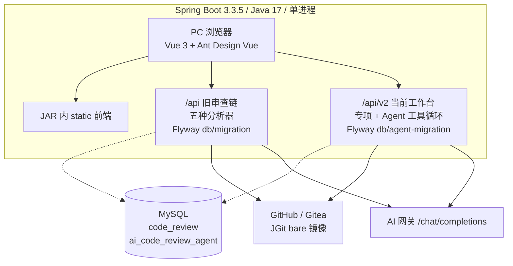
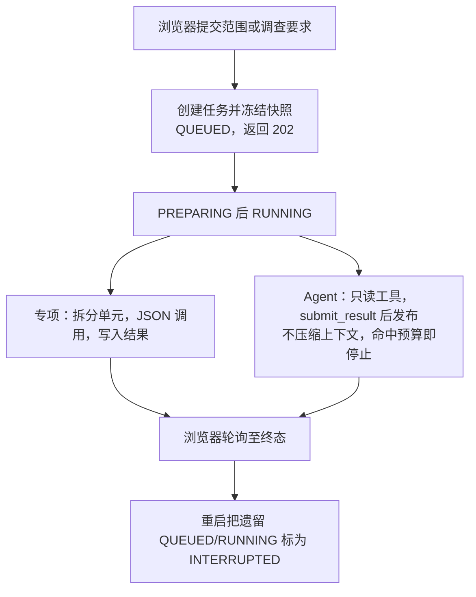
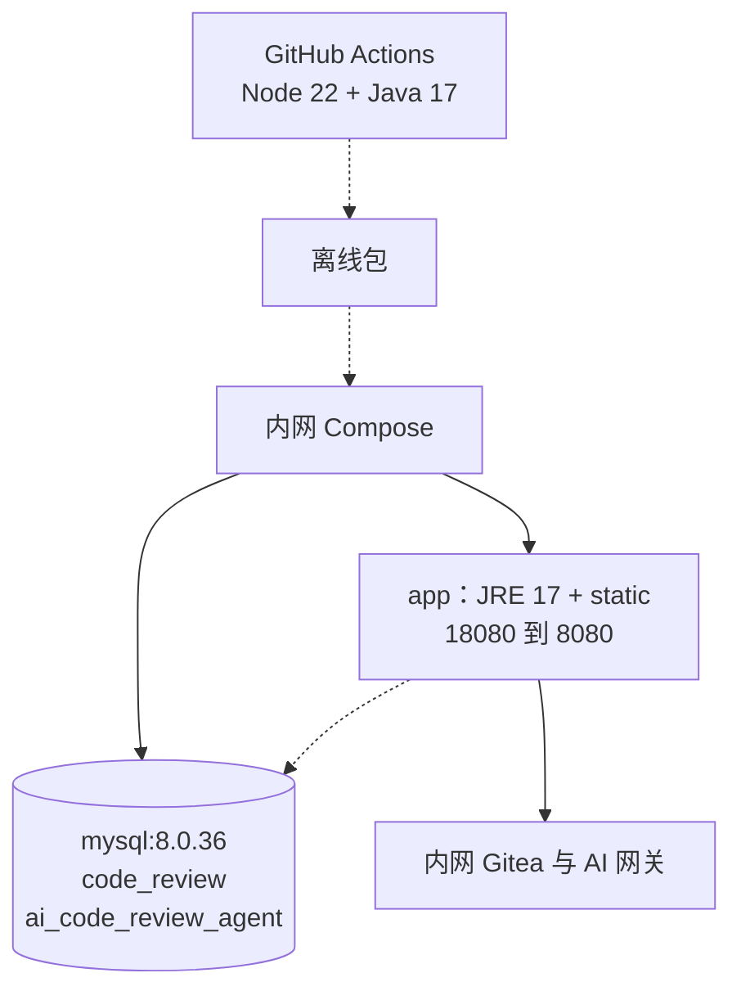

# 系统图源

本文是技术报告与用户手册中三张插图的来源说明。适用源码为 dev 分支 `3025dfed67e7b7c013d88b77d579f9e7c43ebac9`（2026-10-22，PR #4）。

`figures/` 中的 SVG 是稳定插图，PNG 由 `make_figures.py` 经 `rsvg-convert` 导出。Word 按约 6.49 英寸宽嵌入 PNG。下面的 Mermaid 与插图表达同一结构，重新布局时以 SVG 为准。

图例：绿色实线表示调用或控制流；蓝色虚线表示数据库读写；棕色虚线表示离线包传递。

## 图 1 系统逻辑架构

浏览器通过同源 HTTP 访问同一个 Spring Boot 进程。该进程同时提供 JAR 内的 static 前端。`/api` 旧审查链随主库启动，包含五种分析器。`/api/v2` 只有配置了新库地址才注册，承载专项审查、Agent 只读工具和现行报告。两个库都在 MySQL 中，迁移历史表分开。Git 宿主为 GitHub 或 Gitea，Gitea 差异和 Agent 检索使用 JGit bare 镜像。模型网关使用 OpenAI Chat 兼容的 `/chat/completions`。

- PNG：[figures/architecture.png](figures/architecture.png)
- SVG：[figures/architecture.svg](figures/architecture.svg)
- Mermaid：[figures/architecture.mmd](figures/architecture.mmd)

## 图 2 专项审查与 Agent 分析

浏览器向 `/api/v2/review-tasks` 或 `/api/v2/agent-tasks` 提交，服务冻结快照后返回 202。专项按文件或差异调用模型并写入结果。Agent 原样回放历史，只读调用工具，只有 `submit_result` 才发布结果。命中预算不追加总结。重启时未完成任务标为失败，原因为 INTERRUPTED。旧 `/api` 审查仍由 ReviewExecutor 执行，当前菜单不进入。

- PNG：[figures/review-sequence.png](figures/review-sequence.png)
- SVG：[figures/review-sequence.svg](figures/review-sequence.svg)
- Mermaid：[figures/review-sequence.mmd](figures/review-sequence.mmd)

## 图 3 内网离线部署拓扑

GitHub Actions 用 Node 22 与 Java 17 构建 linux/amd64 镜像，并带上 mysql:8.0.36 组成离线包。内网 Compose 发布应用端口，默认 18080 转到容器 8080。MySQL 不发布宿主端口。模板创建 `code_review`。`ai_code_review_agent` 需另行创建并写入 `agent.datasource` 后，`/api/v2` 才注册。应用镜像回退不回退两套 Flyway 历史。

- PNG：[figures/deployment.png](figures/deployment.png)
- SVG：[figures/deployment.svg](figures/deployment.svg)
- Mermaid：[figures/deployment.mmd](figures/deployment.mmd)

## 代码依据

| 图 | 依据 | 核对内容 |
| --- | --- | --- |
| 图 1 | `frontend/package.json`，`backend/pom.xml`，`Dockerfile` | Vue 3、Ant Design Vue、Spring Boot 3.3.5、Java 17、前端打入 JAR |
| 图 1 | `agent/db/AgentDatabase.java`，`AgentSchemaGuard.java` | 新库独立迁移，拒绝带有 `flyway_schema_history` 的库 |
| 图 1 | `analyzer/*Analyzer.java`，`agent/tools/AgentToolNames.java` | 旧五种分析器仍在；Agent 工具为 tree、find_files、search_code、read_code、read_diff、submit_result |
| 图 2 | `agent/execution/AgentTaskWorker.java`，`AgentBudget.java`，`TaskRecoveryRunner.java` | 预算、不压缩、不恢复，启动时把遗留任务标为 INTERRUPTED |
| 图 3 | `deploy/docker-compose.yml`，`deploy/config/application.yml.example`，`.github/workflows/release.yml` | 单 MySQL 容器、默认不配置新库、离线包内容 |
