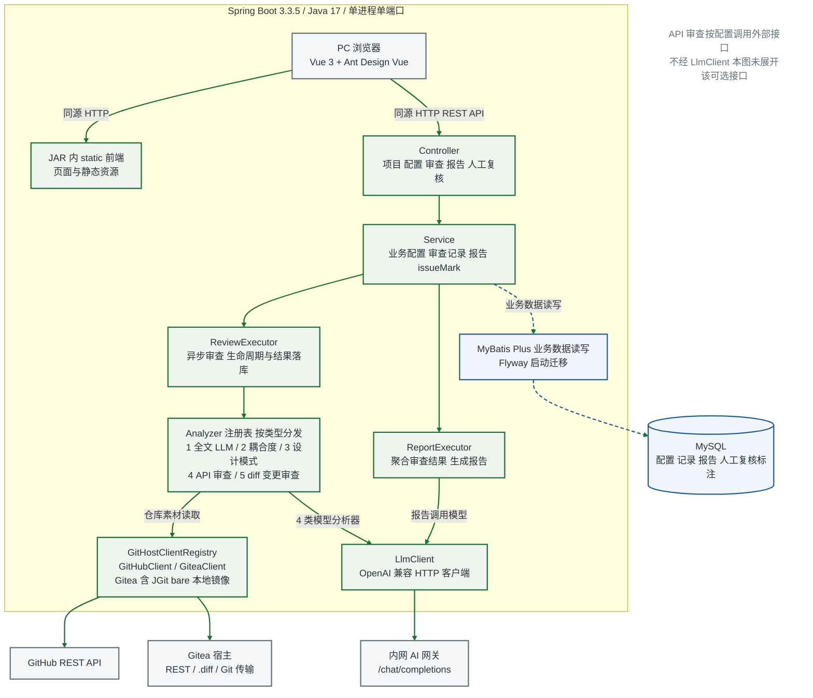
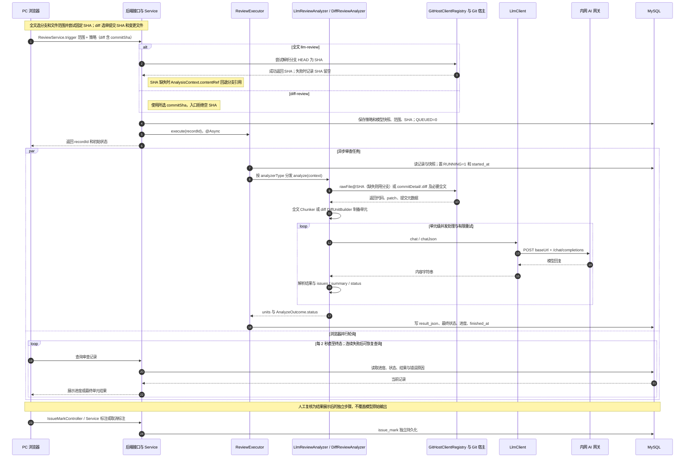
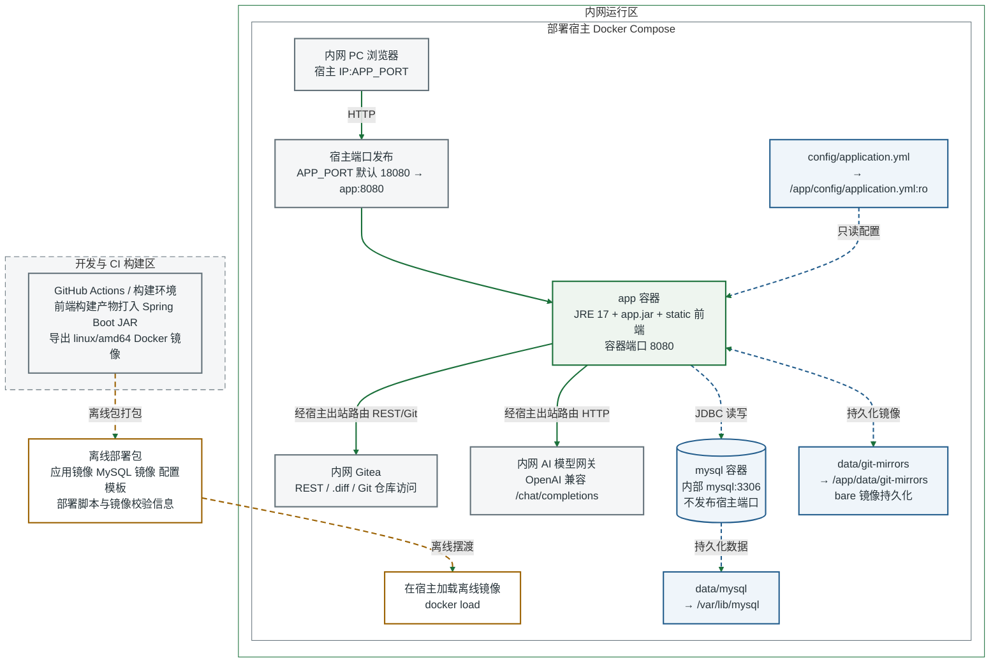

# aiCodeReview 系统图集

本文配套技术报告与用户手册，给出可嵌入 Word 的 PNG、可编辑 SVG，以及对应的 Mermaid 源码。系统图对应 `dev` 分支提交 `d114f622674c5de97196f8eab37c6933ee4da1cb`，核验日期为 2026 年 10 月 13 日。

图例约定：绿色实线箭头表示调用或控制流；蓝色虚线箭头表示数据库读写或持久化；灰色虚线箭头表示返回数据；棕色虚线箭头表示离线部署包传递。普通实线边界表示进程、容器或运行区；构建区的灰色虚线边界表示构建环境与内网运行环境分离。

三张图按 6.49 英寸宽插入 Word 时，最小文字等效字号约为 8.18 pt。保持纵横比，避免再次缩窄或压缩。

## 图 1 系统整体架构

浏览器通过同源 HTTP 使用 Vue 3 和 Ant Design Vue 前端。前端构建产物位于 Spring Boot JAR 的 `static` 目录，由一个 Java 17 进程提供静态资源与 REST API。Controller 和 Service 处理项目、策略、模型、提示词、审查、报告及人工复核；ReviewExecutor 和 ReportExecutor 负责各自的异步任务。

ReviewExecutor 按类型选择五类 Analyzer。全文 LLM、diff、耦合度及设计模式分析涉及模型调用，使用 LlmClient 访问 OpenAI 兼容网关；API 审查按配置调用外部接口，不经 LlmClient。GitHostClientRegistry 按仓库宿主选择 GitHubClient 或 GiteaClient；Gitea 的单提交 patch 经 REST `.diff` 获取，比较差异由 JGit bare 本地镜像辅助。业务配置、记录、报告和人工标注保存在 MySQL，MyBatis Plus 执行业务读写，Flyway 负责数据库迁移。

Word 插图： [PNG](figures/architecture.png)；可编辑图： [SVG](figures/architecture.svg)；独立源文件： [Mermaid](figures/architecture.mmd)。PNG 为 3200 × 3300 pixels，300 dpi；按 6.49 英寸宽插入时，高度约 6.69 英寸。

## 图 2 全文与单提交变更审查时序

全文审查从分支与文件范围发起，ReviewService 尝试将分支 HEAD 解析为具体 SHA；解析失败时 SHA 留空，AnalysisContext.contentRef 回退到分支引用。diff 审查由用户选择一个提交，服务要求 `commitSha` 非空。服务保存策略和模型快照、范围及已取得的提交 SHA，创建排队状态记录，随后提交异步任务并向浏览器返回记录标识。

文件与 patch 的读取、Chunker 或 DiffUnitBuilder 的单元制备、模型回复解析均位于相应 Analyzer。ReviewExecutor 负责分发、进度及最终结果落库。浏览器每 2 秒并行轮询查询记录；图中底部查询表示最终一次轮询，不能理解为轮询只在任务结束后开始。模型输出保留在审查结果中，用户随后通过 IssueMarkController 和 IssueMarkService 独立标注或取消标注。

Word 插图： [PNG](figures/review-sequence.png)；可编辑图： [SVG](figures/review-sequence.svg)；独立源文件： [Mermaid](figures/review-sequence.mmd)。PNG 为 4000 × 4500 pixels，300 dpi；按 6.49 英寸宽插入时，高度约 7.30 英寸，适合独立图页。

## 图 3 内网离线部署拓扑

构建环境将前端资源打入 Spring Boot JAR，导出 `linux/amd64` 应用镜像，并与 MySQL 镜像、配置模板及部署脚本组成离线部署包。部署包经离线传递后在内网宿主加载，不需要把开发构建环境连接到内网数据库。

浏览器访问宿主发布端口 `APP_PORT`，默认 `18080`，映射到 app 容器的 `8080`。app 使用 JRE 17 运行 `app.jar` 和内置静态前端。MySQL 仅在 Compose 网络中提供 `mysql:3306`，没有发布宿主端口。配置文件只读挂载，Git bare 镜像与数据库数据分别保存在宿主的 `data/git-mirrors` 和 `data/mysql`。app 经宿主出站路由访问内网 Gitea 和模型网关。

Word 插图： [PNG](figures/deployment.png)；可编辑图： [SVG](figures/deployment.svg)；独立源文件： [Mermaid](figures/deployment.mmd)。PNG 为 3200 × 3200 pixels，300 dpi；按 6.49 英寸宽插入时，高度约 6.49 英寸。

## 代码证据索引

| 图 | dev 仓库中的依据 | 核验内容 |
| --- | --- | --- |
| 图 1 | `frontend/package.json`；`backend/pom.xml`；`Dockerfile` | Vue 3、Ant Design Vue、Spring Boot 3.3.5、Java 17、前端 static 打入 JAR |
| 图 1 | `backend/src/main/java/com/codereview/service/ReviewExecutor.java`；`ReportExecutor.java`；`analyzer/*Analyzer.java` | 异步执行器、5 类 Analyzer、报告模型调用、API 审查的外部调用 |
| 图 1 | `backend/src/main/java/com/codereview/git/GitHostClientRegistry.java`；`GiteaClient.java`；`GiteaGitMirror.java` | 宿主注册表、REST .diff、比较差异与 bare 镜像 |
| 图 1 和图 2 | `backend/src/main/java/com/codereview/llm/LlmClient.java` | `baseUrl + /chat/completions` 模型接口 |
| 图 2 | `backend/src/main/java/com/codereview/service/ReviewService.java`；`ReviewExecutor.java` | SHA 选择规则、配置快照、QUEUED、异步分发、执行状态与结果落库 |
| 图 2 | `backend/src/main/java/com/codereview/analyzer/LlmReviewAnalyzer.java`；`DiffReviewAnalyzer.java`；`chunk/Chunker.java`；`diff/DiffUnitBuilder.java` | 宿主素材读取、单元制备、模型调用与解析所在层次 |
| 图 2 | `frontend/src/views/ProjectDetail.vue`；`backend/src/main/java/com/codereview/controller/IssueMarkController.java`；`service/IssueMarkService.java` | 每 2 秒轮询、轮询恢复、独立人工标注 |
| 图 3 | `deploy/docker-compose.yml`；`Dockerfile` | app 端口、内部 MySQL、配置只读挂载、两个持久化目录、JRE 17 镜像 |
| 图 3 | `.github/workflows/release.yml`；`deploy/scripts/deploy.sh` | 镜像构建、离线打包、校验和镜像加载流程 |

图中的箭头表示主要结构和数据流，不展开每个 DTO、Mapper、缓存或异常分支。时序图适用于普通逐单元审查；全文多文件合并模式改为拼接后一次模型调用，仍使用同一记录、快照、异步执行和持久化路径。

Mermaid 语法参考：[官方流程图语法](https://mermaid.js.org/syntax/flowchart.html)。PNG 与 SVG 为按相同结构单独绘制的稳定插图；Mermaid 可在支持该语法的编辑器中重新布局。
