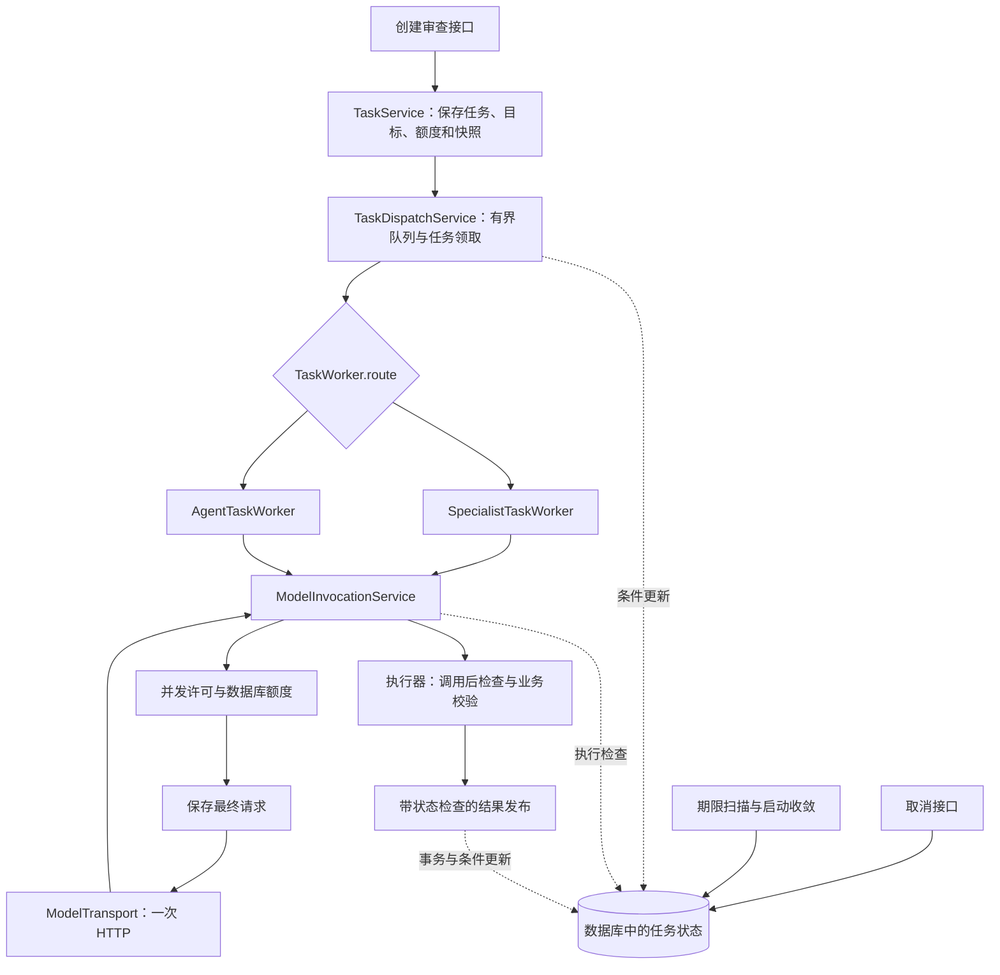
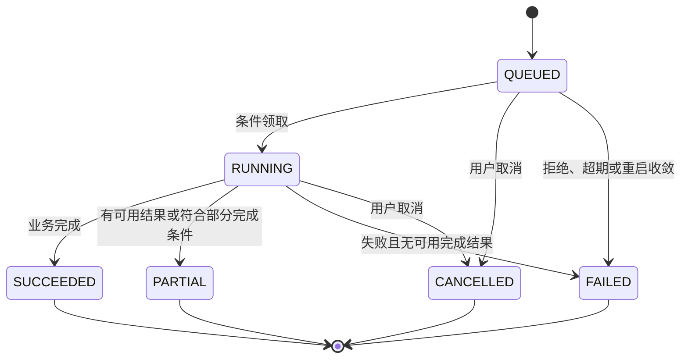
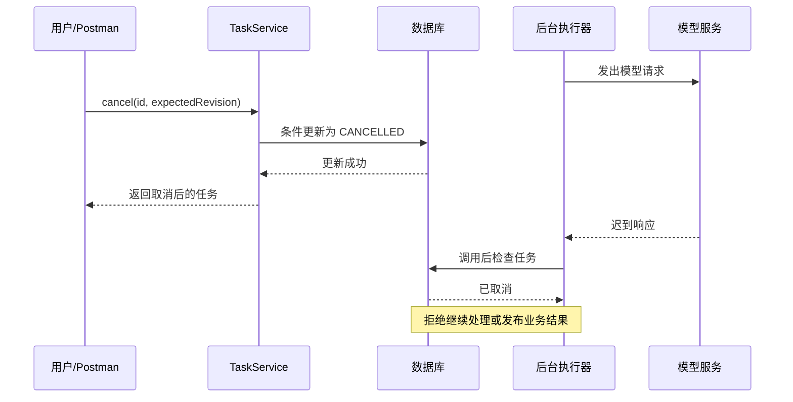

# 任务调度与模型调用控制：从设计思想到代码实现

## 术语表

| 术语 | 本报告中的含义 | 对应代码或数据 |
| --- | --- | --- |
| 任务（Task） | 一次用户发起的专项审查或 Agent 调查，包含输入、状态和执行期限 | `AgentReviewTask`、`review_task` |
| 路线（Route） | 决定由哪一种执行器处理任务 | `SPECIALIST`、`AGENT`、`TaskWorker.route()` |
| 目标（Target） | 专项任务中一个被审查的文件；一个任务可以包含多个目标 | `AgentTaskTarget` |
| 执行单元（Unit） | 一个目标实际送入模型的处理单元，可能是整个文件，也可能是拆分片段 | `AgentExecutionUnit` |
| 轮次（Turn） | Agent 中一次请求模型决定下一步的循环；一次轮次可能发生传输重试 | `AgentRun.turnNo` |
| 调用记录（Call） | 公共调用层为一次模型请求尝试保存的请求、响应、状态和错误 | `AgentModelCall`、`model_call` |
| 业务结果（Result） | 经过业务协议检查并正式发布的审查结论 | `AgentReviewResult` |
| 异步受理 | 接口接受任务后由后台处理；HTTP 响应不等待审查完成 | HTTP `202`、`dispatcher.dispatch()` |
| 调度（Dispatch） | 将已创建的任务提交给进程内工作线程，并选择执行路线 | `TaskDispatchService` |
| 背压（Backpressure） | 待处理工作超过承载能力时拒绝或限制新增工作，避免无限积压 | 有界调度队列、拒绝策略 |
| 状态机 | 用允许的状态及转换约束任务生命周期 | `TaskStates`、条件更新 |
| 终态 | 业务上已经结束的状态，迟到的正常回调不应重新打开它 | `SUCCEEDED`、`PARTIAL`、`FAILED`、`CANCELLED` |
| 条件更新 | 只有数据库当前值满足前提时才修改；更新行数代表是否取得推进资格 | SQL `UPDATE ... WHERE ...` |
| 乐观并发控制 | 基于预期版本或状态更新，发生竞争时由受影响行数识别冲突 | `expectedRevision`、`revision` |
| 行锁 | 在短事务中锁定任务行，使发布等竞争操作按顺序完成 | `SELECT ... FOR UPDATE` |
| 幂等键 | 用于识别同一项目下的重复创建请求；相同请求可返回原任务 | `Idempotency-Key`、唯一索引 |
| 快照 | 创建任务时保存的输入、模型信息、规则或预算，避免执行时随配置漂移 | `inputSnapshot`、`configSnapshot` |
| 执行检查（Guard） | 在继续工作前重新读取任务，检查取消、终态和期限 | `TaskExecutionGuard` |
| 协作式取消 | 先保存取消决定，后台在检查点发现后停止后续工作 | `TaskService.cancel()`、`requireActive()` |
| 迟到响应 | 请求发出后，任务已取消或超时，但远端随后返回的响应 | 调用后检查、结果发布检查 |
| 执行期限（Deadline） | 整个任务允许执行到的绝对时间；排队和重试等待也消耗这段时间 | `deadlineAt` |
| 调用超时（Timeout） | 当前一次网络调用最多等待多久，受剩余任务期限约束 | `timeoutFor()`、`HttpRequest.timeout()` |
| 并发许可（Permit） | 允许进入公共模型调用区段的一份资源；取得后必须释放 | `Semaphore`、`Permit.close()` |
| 额度预留（Reservation） | 在准备发送一次请求前占用一个调用名额，通过数据库条件更新保证不超限 | `task_quota.reserved`、`hard_limit` |
| 传输重试 | 对连接失败、限流等暂态故障重新尝试请求 | `ModelInvocationService.invoke()` |
| 格式重试 | 对专项返回的 JSON 或业务结构错误重新请求模型纠正 | `SpecialistProtocolPolicy` |
| 退避（Backoff） | 重试前等待一段时间，并受最大等待、随机扰动和剩余期限约束 | `RetryBackoff`、`waitBeforeRetry()` |
| 事务发布 | 在一次数据库事务中检查并写入结果及必要状态，失败时整体回滚 | 专项发布事务、`AgentResultPublisher` |
| 重启收敛 | 进程启动后，把上次遗留的未完成工作明确结束为中断，不恢复原执行 | `TaskRecoveryRunner` |

## 1. 阅读范围与业务背景

本报告面向正在学习本项目后端代码的开发者，解释「系统如何执行任务，以及如何在失败、取消、超时和重启后维持可解释的状态」。阅读路线是：业务背景 → 设计哲学 → 代码框架 → 设计模式 → 具体实现 → 竞争场景 → 测试与调试。

源码依据为 `dev` 分支提交 `52f1c044fa6d558c6e9b5f20b16891f53b1f2d9a` 的当前工作树，核对日期为 2026-11-02。报告以当前 `com.codereview.agent` 实现为主，不把已停用的 `com.codereview.service.ReviewExecutor` 作为现行调度器。历史文档和源码注释可能保留阶段性措辞；发生差异时，以实际调用和条件更新为依据。

本报告是代码学习材料，不新增业务契约，不修改配置或实现，不代表已经完成并发压力、真实数据库竞争或目标部署环境验收。本轮仅阅读源码、现有测试和交付记录，没有运行任务、测试或真实模型调用。

### 1.1 为什么审查任务需要独立的执行控制

一次审查远不止「接收参数 → 调模型 → 返回答案」。它需要解析固定仓库版本、收集材料、生成提示词、等待模型并发许可、访问外部服务、检查返回结构，并保存可追溯结果。多文件任务还可能并行执行；Agent 会反复调用模型和工具。

这些步骤的耗时和失败位置都不确定。用户可能在等待时取消，网关可能在已经处理请求后断开连接，进程可能在数据库提交与调度之间退出。可靠性的主要问题由此变成：发生这些事件时，谁有权继续工作，谁有权修改状态，哪些记录必须保留。

### 1.2 必须区分的三种「成功」

| 层级 | 成功意味着什么 | 不能据此推断什么 |
| --- | --- | --- |
| HTTP 创建接口 | 任务被受理，返回可查询的任务对象 | 不代表任务已完成；后台也可能已经快速失败 |
| 模型调用 | 一次响应满足公共调用层的要求，并保存了响应 | 不代表专项业务结构合格，也不代表结论正确 |
| 审查任务或结果 | 执行器完成业务检查，按发布规则保存结果并推进状态 | 不代表模型结论已经过人工真伪确认 |

例如，专项模型返回了合法的响应信封，但正文里的证据引用不合法，公共调用后仍需由专项解析器和校验器拒绝。`SpecialistTaskWorker.executeUnit()` 还可能把对应调用记录改记为 `MODEL_OUTPUT_INVALID`。

### 1.3 任务、文件、片段、调用的关系

```text
专项任务
├─ 目标文件 A
│  ├─ 执行单元 A1 → 一次或多次模型请求尝试
│  └─ 执行单元 A2 → 一次或多次模型请求尝试
└─ 目标文件 B
   └─ 执行单元 B1 → 一次或多次模型请求尝试

Agent 任务
└─ 多轮循环
   ├─ 请求模型 → 执行工具 → 将工具材料加入下一轮
   └─ 请求模型 → 显式提交结果或命中限制
```

因此，一个目标失败不一定导致整个任务毫无可用结果。任务、目标、单元和调用记录需要分别表示状态，不能共用一个布尔值。

## 2. 设计哲学：先定义必须守住的事实

这一部分是对代码设计的归纳，不是原作者逐字陈述的设计宣言。每条思想都能在后续实现中找到对应机制。

### 2.1 数据库状态决定业务事实，线程负责尝试执行

线程中的 `task` 对象是某个时刻读取的副本。另一个请求可能已经把数据库中的任务取消，所以不能因为内存中的状态还是 `RUNNING` 就继续发布。

代码在关键位置重新查询数据库，并在更新时附带状态条件。内存中的工作「做完了」，只说明线程取得了结果；数据库仍允许写入，才说明结果可以成为正式业务事实。

这也是为什么不把 `Future.cancel(true)` 当作取消的唯一依据。中断是进程内的执行信号，数据库中的取消状态才是其他线程、请求和重启后的进程能够共同读取的决定。

### 2.2 把「尽量不再工作」与「绝不覆盖终态」分开保障

调用前的检查减少已经无效的工作；结果发布时的条件更新和事务保护则限制错误写入。两者解决的问题不同。

即使发送前检查通过，取消也可能紧接着发生。外部 HTTP 请求与本地数据库无法通过当前实现组成一个原子动作，因此不能宣称「取消与发送绝无竞争窗口」。系统更明确的保障是：在检查点发现停止条件后不继续调用；已经迟到的工作不能重新把终态改写为成功，结果发布也要再次取得资格。

### 2.3 资源必须有上限，等待也必须有边界

任务调度队列有容量，执行任务数有上限，单任务文件并行数有上限，模型调用还有独立的全局和单任务许可。排队、重试和网络调用都受期限约束。

这里控制的是不同层次的资源：CPU 和工作线程、排队占用、外部模型并发、请求次数以及执行时间。一个「最大线程数」无法替代其他限制。

### 2.4 对有副作用的动作，先留下可追溯记录

模型调用可能收费，也可能返回不可复现的内容。公共调用层在发送前保存最终请求正文；保存失败时，不继续发请求。任务创建也先提交数据库事务，再把任务 ID 交给调度器。

这种顺序可以减少「外部动作已经发生，但系统没有任何记录」的情况。不过，先保存再发送依然存在崩溃窗口，不能由此推导出外部调用恰好执行一次。第 5.7 节说明其具体边界。

### 2.5 重试需要确定的理由、次数与总预算

传输失败和返回格式错误由不同层处理。HTTP 传输实现只进行一次请求，公共调用层决定暂态重试，专项执行器决定格式纠正。每次进入公共请求尝试仍受同一任务额度约束。

这能避免每层都自行重试而难以计算消耗。分层并不意味着重试总数不会相乘；实际消耗仍取决于目标数、片段数、格式尝试数及每次允许的传输尝试数。

### 2.6 用明确的失败和部分完成表达损失

任务没有执行器时明确失败，调度队列满时明确失败，进程重启后把遗留任务标为中断。专项中部分文件成功时可返回 `PARTIAL`，不会因为另一个文件失败就把全部结果伪装为成功或全部丢弃。

这里的可靠性是「边界清楚、状态可解释、结果不被迟到操作破坏」，不等于每个任务最终都会成功。

## 3. 代码框架：入口、执行、调用、发布四层

### 3.1 主要职责

| 层次 | 关键代码 | 负责什么 |
| --- | --- | --- |
| 接口与创建 | `ReviewTaskV2Controller`、`TaskService` | 参数、幂等、固定版本、快照、初始状态和额度 |
| 调度与公共生命周期 | `TaskDispatchService`、`TaskWorker`、`TaskStates` | 队列、任务领取、路线选择、任务终态 |
| 专项业务执行 | `SpecialistTaskWorker` | 逐文件材料、拆分、模型调用、协议检查与结果聚合 |
| Agent 业务执行 | `AgentTaskWorker` | 模型与工具循环、轮次和工具预算、显式提交 |
| 公共模型调用 | `ModelInvocationService` | 容量、状态检查、许可、额度、记录、传输重试 |
| 一次 HTTP 传输 | `ModelTransport`、`HttpModelTransport` | 实际请求、响应及传输错误，不自行重试 |
| 执行状态检查 | `TaskExecutionGuard` | 取消、终态和期限检查，提供带行锁的发布检查 |
| 结果发布 | `SpecialistResultPublisher`、`AgentResultPublisher` | 保存经过校验的业务结果及关联信息 |
| 异常状态收敛 | `TaskDeadlineSweeper`、`TaskRecoveryRunner` | 超期扫描、启动后结束遗留任务 |

### 3.2 执行关系



图中将公共步骤合并展示，真实调用顺序以第 5 节为准。尤其不能把「调用返回」直接连成「任务成功」，中间还有停止检查、结构校验和发布事务。

### 3.3 三条控制路径

正常路径是「创建 → 排队 → 执行 → 调用 → 校验 → 发布」。停止路径是「取消或期限到达 → 保存终态 → 后台检查发现 → 停止后续工作」。补偿路径是「进程退出导致后台消失 → 下次启动扫描 → 将未完成记录明确结束」。

三条路径可能竞争同一任务行，所以不能分别无条件写状态。数据库更新前提构成它们共同遵守的规则。

报告生成另外使用 `ReportGenerationService` 和 `ReportExecutionWorker` 管理自己的调度和状态，再复用公共模型调用能力。报告调用使用 `InvocationScope.standalone(deadline)`，不能把专项任务的 `taskId`、任务额度和取消语义直接套到报告上。

## 4. 设计模式：从实际用途理解，避免机械贴标签

| 设计手法 | 项目中的体现 | 为什么适合这里 | 边界 |
| --- | --- | --- | --- |
| 策略模式 | `TaskWorker` 的专项与 Agent 实现，按 `route()` 选择 | 调度器处理共同生命周期，执行器处理不同业务算法 | 不是每个专项类型都有一个 `TaskWorker` |
| 组合与依赖注入 | Worker 注入组装、材料、调用和发布服务 | 可以独立阅读和替换依赖，也便于使用测试替身 | 没有强行让所有流程继承一个巨型基类 |
| 显式状态机 | `TaskStates` 配合受约束的数据库更新 | 状态与转换前提集中可见，竞争时可以拒绝写入 | 不是经典的「每个状态一个类」的 State 模式 |
| 比较并更新 | 启动检查 `QUEUED + revision`，取消检查预期修订，结束检查前置状态 | 将「是否还能推进」交给数据库原子判断 | 不同转换的条件不同，不是所有更新都检查 revision |
| 资源隔离与背压 | 有界线程池、调度队列、两级模型许可 | 防止任务数量和外部调用一起无限增长 | 这些限制主要位于单进程内，不是跨节点全局限流 |
| 端口与适配器 | `ModelTransport` 接口及 `HttpModelTransport` 实现 | 业务控制不必依赖真实网络；测试可提供响应替身 | 当前 HTTP 适配围绕实际支持的协议实现 |
| 确定性资源释放 | `Permit implements AutoCloseable`，调用层 `finally` 关闭 | 成功、失败和异常退出都需要归还并发许可 | 不需要依赖垃圾回收释放许可 |
| 短事务与条件发布 | `AgentDatabase.inTransaction()`、发布前任务行锁 | 使结果保存与必要状态变化一致 | 数据库事务不覆盖远端模型计算 |

这里没有通用工作流引擎、持久消息队列、事务发件箱或分布式租约。学习重点是少量机制如何组合，而不是把现有代码解释成它并未实现的基础设施。

## 5. 具体实现：沿一份专项任务逐步阅读

### 5.1 创建：先固化输入，再异步执行

入口为 `POST /api/v2/review-tasks`，控制器调用 `TaskService.create()`。

创建过程先解析项目、模型和规则，再核对来源版本。文件范围需要确认过的 `observedSha`；分支已移动时，在创建任务前返回 `SOURCE_MOVED`，避免后续悄悄审查另一个版本。

然后建立 `QUEUED` 任务，保存输入与配置快照、`revision=0`、创建时间和 `deadlineAt`。任务、目标和调用额度在 `db.inTransaction()` 中共同写入；事务返回后才执行 `dispatcher.dispatch(task.getId())`。

这个边界有两个作用。后台不会正常读到只写了一半的任务；数据库写入失败时也不会先把一个未提交的任务交给工作线程。它仍有一个限制：如果在提交后、调度前进程退出，这条任务可能停留在 `QUEUED`，当前通过重启收敛结束，并没有消息队列负责自动重投。

HTTP `202` 表示受理，不能作为最终业务状态。后台很快运行时，返回对象中的状态还可能已经发生变化，客户端应继续查询任务详情。

### 5.2 幂等：阻止重复创建，不承诺外部调用只执行一次

`TaskService.create()` 规范化 `Idempotency-Key`，计算请求摘要。相同项目、相同键和相同请求返回原任务；相同键对应不同请求则冲突。唯一索引 `(project_id, idempotency_key)` 处理两个并发请求都未查到原任务的竞争：插入失败的一方重新读取并判断是否可以返回已有任务。

对已删除任务的幂等键，代码拒绝重用并要求更换。键未提供或为空时，不启用这层重复创建保护。

这里解决的是接口重试造成的重复任务。模型请求超时后重新发送，远端是否已经完成上次计算，是另一个问题；当前没有外部模型提供者层面的恰好一次保证。

### 5.3 调度：排队和领取资格分别处理

`TaskDispatchService` 创建固定大小的 `ThreadPoolExecutor`，使用有界 `ArrayBlockingQueue` 和 `AbortPolicy`。队列满会抛出 `RejectedExecutionException`，`dispatch()` 捕获后尝试把仍为 `QUEUED` 的任务标为 `FAILED / DISPATCH_REJECTED`。

工作线程中的 `run(taskId)` 先读任务。已经取消或结束的任务不再执行。随后 `markRunning()` 用一次条件更新取得资格。

以下为便于理解的等价 SQL，省略时间字段及 MyBatis 的逻辑删除处理，不是源码中手写的完整 SQL：

```sql
UPDATE review_task
SET state = 'RUNNING', revision = revision + 1
WHERE id = :taskId
  AND state = 'QUEUED'
  AND revision = :revisionReadEarlier;
```

若两个执行尝试都读到同一个修订，只有第一个能成功更新。第二个更新 0 行，说明它不再有权启动任务。关键不是「刚才查过状态」，而是更新当下仍满足前提。

`selectWorker()` 从注入的 `TaskWorker` 中按路线选取执行器；没有匹配实现就结束为 `EXECUTOR_UNAVAILABLE`。执行器返回 `TaskOutcome`，其构造器只接受终态，调度器不自行猜测业务是否完成。

### 5.4 状态转换：终态是一项写入约束



图中是任务层状态；`PREPARING` 主要用于专项目标，不应混进任务状态转换图。Agent 的部分完成条件还包括已经进行工具调查，和专项的成功目标判断不同。

`finish()` 只修改仍处于 `RUNNING` 的任务；写成功还要求 `cancelRequestedAt IS NULL`。`terminate()` 只修改 `QUEUED` 或 `RUNNING`。更新 0 行时不会继续重写目标，避免失败的竞争操作破坏已经完成的数据。

`TaskStates` 的注释概括了修订保护，但阅读时应继续查看具体 SQL 条件：启动和用户取消显式使用 revision，普通结束主要使用前置状态。不能把所有更新都理解成同一种乐观锁模板。

### 5.5 并发：任务、文件、模型请求是三个层次

| 层次 | 代码 | 源码默认值 | 控制对象 |
| --- | --- | --- | --- |
| 同时执行任务 | `TaskProperties.dispatchConcurrency` | 4 | 调度池中的任务 |
| 等待调度任务 | `TaskProperties.dispatchQueueCapacity` | 64 | 等待调度的任务数量 |
| 单任务并行文件 | `SpecialistExecutionProperties.parallelTargets` | 4 | 同一专项任务内的目标处理 |
| 全局模型许可 | `ModelInvocationProperties.globalConcurrency` | 4 | 当前进程公共模型调用区段 |
| 单任务模型许可 | `ModelInvocationProperties.perTaskConcurrency` | 2 | 一个任务占用的模型调用区段 |

这些是代码默认值，可被运行配置覆盖，不能据此断言当前进程实际配置。文件任务可以并行读取与准备材料，但进入模型调用时仍需许可。例如，4 个文件线程不意味着这个任务能同时发送 4 个模型请求。

`ModelCallConcurrencyLimiter.acquire()` 先取得全局许可，再取得任务许可。第二步失败时必须释放已取得的全局许可。返回的 `Permit.close()` 按相反顺序释放，重复关闭不会重复归还。

它的实际保护范围要看 `invoke()` 的 `try/finally`：许可不仅覆盖网络等待，还覆盖该次尝试内的额度处理、调用记录、响应处理等步骤，直到退出 `try` 才释放。不能只按类注释理解成精确的「纯 HTTP 同时请求数」。

等待并发许可也消耗期限。没有期限时使用有限等待；有期限时取剩余时间并限制最长等待。它不是在整个等待期间持续轮询取消状态，但取得许可后公共调用层会重新检查任务。

### 5.6 公共调用：检查必须围绕耗时步骤重复进行

`ModelInvocationService.invoke()` 的实际主顺序如下：

```text
校验模型与有效策略
→ 估算或检查上下文容量
→ 生成最终请求 JSON
→ 对每次允许的传输尝试：
    检查任务状态与剩余期限
    → 等待并发许可
    → 再次检查任务状态与期限
    → 原子预留一次调用额度
    → 保存 RUNNING 调用记录和最终请求
    → 再次检查任务状态，重新计算本次超时
    → 执行一次 HTTP
    → 保存响应或失败
    → finally 释放许可
    → 必要时检查状态并等待重试
```

重复检查并非无意义的重复。等待许可可能耗费几秒甚至更久，保存请求也可能跨过取消或期限。发送前不能沿用等待之前的判断。

容量检查也有业务差异：未启用智能拆分的专项完整发送模式使用保守估算作诊断，不因为本地估算超限就必然拒绝；其他请求按相应路径执行容量限制。可靠执行应尊重这个已经存在的策略边界。

### 5.7 额度：用原子 SQL 防止并发超领

如果先查 `reserved` 再执行加一，两个线程可能同时读到剩余 1 次，随后都认为自己能发送。当前用数据库条件更新解决这个问题。

以下为简化后的等价 SQL：

```sql
UPDATE task_quota
SET reserved = reserved + 1
WHERE task_id = :taskId
  AND reserved < hard_limit;
```

只有成功更新才能继续。额度耗尽时，在发送前抛出 `QUOTA_EXCEEDED`。正常专项创建会建立额度行；要求冻结策略的调用若缺少额度，则返回 `CONFIG_INCOMPLETE`，不会临时扩大额度。

`reserved` 是保守的发送前预留，不是模型实际计费次数。额度预留成功后，如果请求记录写入失败或再次检查发现取消，网络可能未发送，但预留已经发生；此路径没有在这里退还额度。这样优先守住上限，但统计时不能直接把预留数当成远端实际调用数。

同理，保存 `RUNNING` 调用记录后可能在发送前被取消，代码会把这条未发送的记录记为失败。`model_call` 的存在也不是远端已经收到请求的充分证据。

### 5.8 最终请求：先保存，再发送

`requestBody()` 把有序消息、模型名、输出预留、结构化输出设置及适用的工具定义序列化为 `body`。`startCall()` 保存的正文与随后交给 `transport.post()` 的是同一个字符串。

由此可以回答「这个模型实际准备接收哪些内容」，而不必用今天的模板重建昨天的请求。凭据由 HTTP Authorization 头发送，不进入该请求正文。

但本地保存与外部服务仍有不可消除的间隔：记录保存后崩溃，可能没有发送；发送后响应丢失，可能无法判断远端是否已处理。因此该设计提供的是可追溯尝试和保守控制，不是跨数据库与模型服务的分布式事务。

### 5.9 时间：总期限持续减少，单次超时随之缩短

`deadlineAt` 是任务创建时确定的绝对时间。排队就已经开始消耗期限，不是等到线程真正执行才起算。

`timeoutFor()` 先取得配置中的单次读超时上限，再与请求自带上限及任务剩余期限比较。任务期限路径还减去 1 秒作为余量；剩余时间不足时直接拒绝发送。

可以把规则理解为：

```text
本次允许等待时间
= min(配置的读超时上限，请求指定上限，剩余任务时间 - 1 秒)
```

公式只表达存在相应参数时的限制，不能省略「剩余时间不足则失败」这个分支。它也不表示一定在期限那一毫秒杀死所有线程；网络超时、执行检查、扫描器和迟到发布保护共同处理不同阶段。

`TaskDeadlineSweeper` 定期扫描已到期而未结束的任务。专项已有成功目标时收敛为 `PARTIAL`，否则为 `FAILED`；Agent 则检查是否已有工具调查。扫描用于最终状态收敛，不替代每次调用前的期限检查。

### 5.10 重试：不同错误由不同层负责

| 失败类别 | 处理层 | 主要行为 |
| --- | --- | --- |
| 401、403 | 公共调用层 | 认证失败，不做同样的传输重试 |
| 429、5xx、连接失败或超时 | 公共调用层 | 按有效策略有限重试，受额度和期限限制 |
| 明确的上下文超限 | 容量和专项规划路径 | 不当作普通暂态网络故障无限重发 |
| 专项正文格式或结构错误 | `SpecialistTaskWorker` | 最多额外纠正 2 次，共 3 次格式尝试 |
| 取消、期限到达 | 执行检查与调用层 | 停止后续工作，不借格式重试绕过 |

`HttpModelTransport` 只发一次请求，避免最底层再隐含重试。公共调用层的 `transportRetries` 表示首次之外的额外次数；源码默认 1，不等于任务最多只会发 2 个请求。

`waitBeforeRetry()` 计算带指数和随机扰动的本地退避。如果网关给出有效 `Retry-After`，等待至少满足该要求，即使它超过本地退避上限，也不会简单缩短。剩余期限不够则停止；等待被拆为小段，每段后重新检查任务。

在常见单文件、单单元且没有容量重规划的情形下，3 次格式尝试各允许 2 次传输尝试，可能达到 6 次网络尝试；这只是帮助理解叠加关系的上界示例，并不是每次都会发生。任务额度还会进一步约束总数。

Agent 另有轮次、网络、工具和无进展等预算。`AgentTaskWorker` 按剩余网络预算缩小本轮传输重试数，例如只剩 1 次网络机会时把额外重试设为 0。新 Agent 任务从配置冻结预算，历史常量不是所有新任务不可变的运行值。

### 5.11 取消：请求写状态，后台在检查点退出

`TaskService.cancel(id, expectedRevision)` 的核心流程如下：

1. 读取当前任务；已经是终态则直接返回当前任务。
2. 检查 `expectedRevision`，发现过期则报告冲突。
3. 条件更新仍为 `QUEUED/RUNNING` 且修订匹配的任务，写入 `CANCELLED`、`USER_CANCELLED` 和取消时间，并递增修订。
4. 将尚未结束的目标更新为取消，保留已经结束的目标。
5. 若竞争更新 0 行，重新读取，区分已经终结与仍需处理的修订冲突。

当前方法没有像创建流程那样显式把任务和目标更新放入同一个 `db.inTransaction()`。因此它们是顺序写入，不能把整个取消过程描述成一个覆盖所有行的原子事务。防止新发布的首要依据仍是已经写入的任务终态。

取消方法也没有直接持有并终止所有工作线程或 HTTP Future。后台通过 `TaskExecutionGuard.requireActive()` 重新读任务后停止；专项协调线程在发现取消或期限异常时，还会尝试取消其他文件 Future。

还有一个容易混淆的细节：执行检查对「任务已经是任意终态」也可能抛出 `TASK_CANCELLED`，并不表示该终态一定由用户取消产生。`AgentTaskWorker.stopBecauseTaskAlreadyClosed()` 会重新读取当前任务，把期限扫描等路径已经写入的状态和停止原因保留到进度记录中。因此，判断结束原因应结合持久状态，不能只看捕获到的异常名称。



这张图表达一种取消先于发布的时序，不表示远端模型一定立即停止计算。调用历史仍可能保存迟到响应，以便解释已经发生的工作；是否成为正式审查结果，需要另外的发布资格。

最后一次状态检查与实际 HTTP 发送之间依然有时间间隔。因此观察调试时，应在发送前的检查尚未执行的位置暂停并确认取消，而不能停在 `transport.post()` 那一行后认为取消必然阻断发送。

### 5.12 结果发布：不同粒度有不同原子边界

专项在一次目标处理完成后，通过 `db.inTransaction()` 执行 `guard.requireActiveLocked(taskId)`、结果发布和目标终态更新。`FOR UPDATE` 锁定任务行，取消若已经先写入，发布会被拒绝；如果发布先取得锁并成功提交，一个文件的已发布结果可以保留，之后的用户取消结束尚未完成的工作。

专项整项任务的终态由文件结果聚合后交给调度器写入。并不是「所有文件结果与任务终态都在同一个大事务中提交」。一个文件失败，不会自动回滚另一个文件已经发布的结果。

Agent 的 `AgentResultPublisher.publish()` 则在同一事务内锁定任务、拒绝取消或已有终态、检查重复结果、插入 Agent 结果并条件更新任务为 `SUCCEEDED`。更新失败抛异常，使本次结果插入回滚。

```text
专项：单目标发布事务 → 多目标聚合 → 调度器写任务终态
Agent：一次事务内发布唯一结果并写任务终态
```

这两种边界对应不同业务：专项允许逐文件形成结果，Agent 的最终提交是一个整体。Agent 在材料不足但协议完整时，还可以以 `SUCCEEDED / INSUFFICIENT_EVIDENCE` 保存完整回答；它与命中限制而没有正式结果的 `PARTIAL` 不是同一种情况。

### 5.13 进程重启：结束遗留执行，而不是继续旧会话

`TaskRecoveryRunner` 在启动时按配置执行。它将遗留的 `QUEUED/RUNNING` 任务、目标、调用和 Agent 运行进度明确收敛，保存 `INTERRUPTED` 等状态；没有从上一条工具或消息继续执行的恢复机制。

其 Agent 进度更新先筛选仍属于未完成任务的运行，避免把已发布成功任务的残留进度误标为中断。各类记录的收敛在当前实现中是多个更新步骤，不是一个跨全部记录的大事务；中间失败仍需按实际持久状态排查。

这一机制明确假设单节点。多节点时，一个实例启动可能把另一个实例的工作误判成遗留任务；关闭 `recover-on-start` 本身也不会自动获得分布式正确性。真正支持多节点还需要任务归属、租约及相应的接管规则，当前不应宣称已经具备。

## 6. 用竞争场景检验设计是否理解正确

| 场景 | 当前关键机制 | 应理解的结果或边界 |
| --- | --- | --- |
| 双击创建，带相同幂等键和请求 | 请求摘要及唯一索引 | 返回同一任务；不等于模型请求跨网络恰好一次 |
| 两个线程尝试启动同一任务 | `QUEUED + revision` 条件更新 | 只有取得更新资格的一方继续 |
| 调度队列已满 | 有界队列和拒绝处理 | 仍排队的任务明确失败，不永久伪装为等待执行 |
| 两个文件只剩最后一个调用名额 | `reserved < hard_limit` 原子更新 | 只有一个成功预留，另一个在发送前停止 |
| 等待许可时发生取消 | 许可获取后的状态复查与 `finally` | 不继续正常发送，已取得的许可需要归还；等待本身未必立即被唤醒 |
| 请求记录写入失败 | 发送前持久化顺序 | 不发送请求；之前预留的额度不在此处自动退还 |
| 保存请求过程中取消 | 保存后再次检查 | 可能留下失败的未发送调用记录 |
| 模型计算时取消 | 调用后检查与发布保护 | 响应可能到达，但不能靠迟到工作覆盖取消终态 |
| 发布先于用户取消提交 | 行锁和状态条件 | 不能承诺取消会撤销已提交结果；最终按取得资格和提交的顺序决定 |
| 传输失败后任务已取消 | 退避中的执行检查 | 不再发下一次重试 |
| 进程在创建事务提交后退出 | 启动收敛 | 遗留任务明确结束为中断，不自动重新入队 |
| 一个文件失败，另一个文件成功 | 逐目标发布及任务结果聚合 | 保留可用结果，任务可以是部分完成 |

阅读这张表时，可以逐项追问三件事：数据库现值是什么；当前线程接下来还需要哪一次检查；最后一个可能写成功结果的位置是否有自己的保护。如果只能回答「前面已经判断过」，通常还没有覆盖并发变化。

## 7. 测试如何表达这些设计思想

以下是已经存在的测试入口和代表性方法，用于把设计说明连接到可执行规格。本报告没有重新运行这些测试。

| 测试类 | 代表性方法 | 要学习的约束 |
| --- | --- | --- |
| `TaskServiceTest` | `concurrentDuplicateKeyReplaysTheExistingTask` | 并发重复创建如何处理 |
| `TaskServiceTest` | `cancelWritesTerminalStateAndClosesOpenTargets` | 取消后的任务和未完成目标状态 |
| `TaskDispatchServiceTest` | `boundedQueueRejectsOverflowInsteadOfLeavingQueuedTasks` | 调度饱和时明确失败 |
| `TaskDispatchServiceTest` | `lateSuccessCannotOverwriteAnAlreadyTerminalTask` | 条件更新拒绝迟到成功 |
| `TaskDispatchServiceTest` | `losingTerminalUpdateCannotRewriteTargets` | 没取得任务更新资格，不继续改目标 |
| `ModelInvocationServiceTest` | `requestPersistenceFailureMeansNoNetworkRequest` | 请求保存失败时禁止发送 |
| `ModelInvocationServiceTest` | `cancellationDuringPersistenceClosesTheUnsentCall` | 保存后取消如何留下未发送失败记录 |
| `ModelInvocationServiceTest` | `timeoutIsRecalculatedAfterRequestPersistence` | 超时不能复用保存前的旧剩余时间 |
| `ModelInvocationServiceTest` | `cancellationDuringBackoffStopsBeforeAnotherNetworkAttempt` | 等待重试期间仍响应停止条件 |
| `ModelCallConcurrencyLimiterTest` | `deadlineBetweenGlobalAndTaskPermitsReleasesTheGlobalPermit` | 取得部分资源后失败，如何避免泄漏 |
| `SpecialistTaskWorkerTest` | `aLateResponseAfterCancellationCannotPublish` | 调用返回后仍需检查是否允许发布 |
| `SpecialistTaskWorkerTest` | `publicationChecksTheLockedTaskState` | 发布前用带锁的当前状态检查 |
| `AgentResultPublisherTest` | `cancelledTasksCannotPublish` | 已取消的任务不能发布 Agent 结果 |
| `AgentTaskWorkerTest` | `singleRemainingNetworkAttemptDisablesRetryWithoutSkippingTheCall` | 剩余预算如何约束公共层重试 |
| `TaskRecoveryRunnerTest` | `restartClosesTasksTargetsAndCallsWithoutResuming` | 重启行为是结束遗留工作 |

许多测试使用 Mapper、事务入口或网络替身，能够验证调用顺序、参数和失败分支，但不能单独证明 MySQL 的真实锁竞争效果、多个进程之间的行为或远端模型是否停止计费。现有 `AgentCancellationLiveTest` 还提供真实数据库取消与发布竞争的测试入口，其触发方式和环境前提应先阅读测试源码，不应因为文件存在就认为本轮执行过。

学习时优先读「为什么不应该继续」的断言，例如 `verify(transport, never()).post(...)`、更新 0 行后的分支，以及取消后结果不得写入的检查。它们比一个正常成功样例更直接地展示实现要守住的边界。

## 8. 建议的源码阅读顺序

| 顺序 | 文件与方法 | 本轮阅读要回答的问题 |
| --- | --- | --- |
| 1 | `TaskStates`、`TaskWorker.TaskOutcome` | 哪些状态允许出现，执行器能返回什么 |
| 2 | `TaskService.create()`、`cancel()` | 哪些事实先保存，取消究竟修改什么 |
| 3 | `TaskDispatchService.run()`、`markRunning()`、`finish()` | 谁能领取任务，谁能推进终态 |
| 4 | `SpecialistTaskWorker.execute()`、`executeTarget()`、`executeUnit()` | 任务、文件、片段如何拆分职责和聚合状态 |
| 5 | `TaskExecutionGuard` | 哪些条件禁止继续执行，发布为何需要带锁检查 |
| 6 | `ModelInvocationService.invoke()` | 一次调用的顺序，检查为何重复出现 |
| 7 | `reserveQuota()`、`ModelCallConcurrencyLimiter`、`timeoutFor()` | 额度、并发和时间分别如何限制资源 |
| 8 | `waitBeforeRetry()`、`SpecialistProtocolPolicy` | 哪种错误在哪一层重试，如何停止 |
| 9 | `AgentResultPublisher`、专项发布事务 | 结果和状态哪些必须一起提交 |
| 10 | `TaskDeadlineSweeper`、`TaskRecoveryRunner` | 工作线程不再可靠推进时，状态如何结束 |
| 11 | 对应失败和竞争测试 | 上述认识能否解释具体断言 |

建议先沿单文件专项理解共同基础，再阅读 Agent 循环。Agent 增加了历史消息、工具执行和多维预算，但数据库状态、公共调用与发布保护仍可复用前面的认识。

## 9. 与 IDEA、Postman 配合的观察路线

本节只是操作说明，本报告编写期间未执行以下流程。该方式会实际创建任务并保存材料；它不等于没有数据库写入的预览模式。

### 9.1 前置条件

先准备可调试的本地后端和唯一一份待观察任务，避免其他任务并行访问模型。发送创建请求前，先在 `ModelInvocationService.invoke()` 内、`String body = requestBody(...)` 之后的 `int attempts = ...` 处设置暂停当前线程的断点。

该位置已经生成最终 JSON，但本次尝试尚未开始额度预留和调用记录保存。应以代码语句定位，避免后续代码变化使固定行号失效。若要用 Postman 在暂停期间取消，断点应只暂停命中线程，使请求处理线程仍能工作。

### 9.2 观察内容

1. 从 `TaskService.create()` 观察事务如何写入任务、目标和额度，以及何时调用调度器。
2. 在 `markRunning()` 观察读取时的 revision 与条件更新结果。注意传给执行器的原对象不一定自动同步成数据库中的新修订。
3. 进入 `executeTarget()`，观察 `prepared`、`enhanced` 和规划后的单元，区分收集材料与最终发送材料。
4. 在公共调用前的断点查看 `scope.taskId()`、`prompt.messages()`、`body` 和 `estimate`。
5. 保持该线程暂停，通过 Postman 查询任务最新 revision，再调用取消接口。
6. 确认返回的任务确为 `CANCELLED` 后，再恢复工作线程，观察后续 `activeScope()` 如何抛出停止异常。

如果取消返回的是已经成功的任务，应按实际终态判断，不能把取消接口 HTTP 成功理解为本次一定取消了执行。调试停留时间也会消耗真实任务期限。

不应为了跳过模型而随意让 `invoke()` 强制返回 `null`，否则只会进入另一条异常路径，不能代表正常的取消机制。也不应通过重复求值 `invocation.invoke(...)` 来观察返回值，因为表达式求值会实际执行方法。

### 9.3 适合核对的观察结果

| 观察点 | 重点 |
| --- | --- |
| 任务领取 | 数据库 revision 递增，重复或失效的领取不能继续 |
| 调用前取消 | 恢复后在状态检查处停止，不进入本次 HTTP 发送 |
| 调用记录 | 暂停在额度预留之前，本次不应已创建模型调用行；其他任务记录不在此判断内 |
| 材料读取 | 发送前材料可能已保存；公开材料列表按调用关联查询，可能仍为空 |
| 调用后取消 | 若请求已经发送，仍可能收到并保存响应；重点看是否拒绝正式发布 |

## 10. 可以复用的思想与当前实现的限制

可复用的思想包括：将请求受理与后台执行分开；用条件更新赋予推进资格；在耗时步骤之后复查状态；通过数据库原子更新预留共享额度；将外部动作前的记录与业务结果发布分开；为已取得的资源建立确定的释放路径。

这些思想可以用于批处理、文件转换和其他长时间任务，但移植时仍需重新定义业务状态及副作用边界。不能直接复制本项目的「取消」「部分完成」或额度含义到另一个系统。

当前实现的主要限制应与优点一起记住：

- 调度和并发许可主要位于进程内，没有持久队列、跨实例全局许可或租约接管。
- 重启后结束遗留任务，不自动继续执行，也不承诺任务最终必达成功。
- 外部模型计算不能和本地状态更新形成一个事务，取消与发送仍有竞争窗口。
- 请求记录和额度均采取发送前的保守处理，不能直接当作远端实际计费凭据。
- 用户取消的任务与目标更新、启动收敛的多个更新步骤，没有被当前代码包在一个统一大事务中。
- 部分源码注释保留旧阶段说明，阅读边界时应追到实际方法和 SQL 条件。
- 逻辑正确性仍依赖真实数据库隔离、外部超时行为和目标部署环境；替身测试不能替代这些验证。

这份实现最值得学习的是如何把几类有限保障组合起来：先明确谁能推进状态，再控制执行成本，最后在正式发布时重新确认资格。每一层只承担能够实际验证的责任，整体行为才容易解释和维护。

## 附录 A：源码与测试入口

下列链接相对本报告所在目录组织，便于在仓库中查阅。正文中的 SQL 和流程图是解释性简化；具体字段、分支和异常以对应源码为准。

| 内容 | 来源 |
| --- | --- |
| 业务约束与停止语义 | [业务契约](../work/agent-redesign/business-contract.md)，重点阅读第 3.3.2、4.5、4.6、4.8 节 |
| 当前启动扫描范围 | [CodeReviewApplication.java](../../backend/src/main/java/com/codereview/CodeReviewApplication.java) |
| 专项任务接口 | [ReviewTaskV2Controller.java](../../backend/src/main/java/com/codereview/agent/api/ReviewTaskV2Controller.java) |
| 创建、幂等与取消 | [TaskService.java](../../backend/src/main/java/com/codereview/agent/service/TaskService.java) |
| 调度与终态 | [TaskDispatchService.java](../../backend/src/main/java/com/codereview/agent/execution/TaskDispatchService.java)、[TaskStates.java](../../backend/src/main/java/com/codereview/agent/execution/TaskStates.java)、[TaskWorker.java](../../backend/src/main/java/com/codereview/agent/execution/TaskWorker.java) |
| 专项执行 | [SpecialistTaskWorker.java](../../backend/src/main/java/com/codereview/agent/execution/SpecialistTaskWorker.java)、[SpecialistResultPublisher.java](../../backend/src/main/java/com/codereview/agent/execution/SpecialistResultPublisher.java) |
| Agent 执行与发布 | [AgentTaskWorker.java](../../backend/src/main/java/com/codereview/agent/execution/AgentTaskWorker.java)、[AgentResultPublisher.java](../../backend/src/main/java/com/codereview/agent/execution/AgentResultPublisher.java) |
| 状态检查与收敛 | [TaskExecutionGuard.java](../../backend/src/main/java/com/codereview/agent/execution/TaskExecutionGuard.java)、[TaskDeadlineSweeper.java](../../backend/src/main/java/com/codereview/agent/execution/TaskDeadlineSweeper.java)、[TaskRecoveryRunner.java](../../backend/src/main/java/com/codereview/agent/execution/TaskRecoveryRunner.java) |
| 公共调用 | [ModelInvocationService.java](../../backend/src/main/java/com/codereview/agent/invocation/ModelInvocationService.java)、[InvocationRequest.java](../../backend/src/main/java/com/codereview/agent/invocation/InvocationRequest.java)、[InvocationScope.java](../../backend/src/main/java/com/codereview/agent/invocation/InvocationScope.java) |
| 并发与网络 | [ModelCallConcurrencyLimiter.java](../../backend/src/main/java/com/codereview/agent/invocation/ModelCallConcurrencyLimiter.java)、[ModelTransport.java](../../backend/src/main/java/com/codereview/agent/invocation/ModelTransport.java)、[HttpModelTransport.java](../../backend/src/main/java/com/codereview/agent/invocation/HttpModelTransport.java) |
| 重试策略 | [RetryBackoff.java](../../backend/src/main/java/com/codereview/agent/invocation/RetryBackoff.java)、[SpecialistProtocolPolicy.java](../../backend/src/main/java/com/codereview/agent/specialist/protocol/SpecialistProtocolPolicy.java) |
| 事务与配置 | [AgentDatabase.java](../../backend/src/main/java/com/codereview/agent/db/AgentDatabase.java)、[TaskProperties.java](../../backend/src/main/java/com/codereview/agent/execution/TaskProperties.java)、[ModelInvocationProperties.java](../../backend/src/main/java/com/codereview/agent/invocation/ModelInvocationProperties.java)、[AgentBudgetProperties.java](../../backend/src/main/java/com/codereview/agent/execution/AgentBudgetProperties.java) |
| 数据库额度与幂等索引 | [V2__agent_execution.sql](../../backend/src/main/resources/db/agent-migration/V2__agent_execution.sql)、[V3__agent_task.sql](../../backend/src/main/resources/db/agent-migration/V3__agent_task.sql) |
| 调度、期限与重启测试 | [TaskDispatchServiceTest.java](../../backend/src/test/java/com/codereview/agent/execution/TaskDispatchServiceTest.java)、[TaskDeadlineSweeperTest.java](../../backend/src/test/java/com/codereview/agent/execution/TaskDeadlineSweeperTest.java)、[TaskRecoveryRunnerTest.java](../../backend/src/test/java/com/codereview/agent/execution/TaskRecoveryRunnerTest.java) |
| 调用与许可测试 | [ModelInvocationServiceTest.java](../../backend/src/test/java/com/codereview/agent/invocation/ModelInvocationServiceTest.java)、[ModelCallConcurrencyLimiterTest.java](../../backend/src/test/java/com/codereview/agent/invocation/ModelCallConcurrencyLimiterTest.java) |
| 业务执行与发布测试 | [TaskServiceTest.java](../../backend/src/test/java/com/codereview/agent/service/TaskServiceTest.java)、[SpecialistTaskWorkerTest.java](../../backend/src/test/java/com/codereview/agent/execution/SpecialistTaskWorkerTest.java)、[AgentTaskWorkerTest.java](../../backend/src/test/java/com/codereview/agent/execution/AgentTaskWorkerTest.java)、[AgentResultPublisherTest.java](../../backend/src/test/java/com/codereview/agent/execution/AgentResultPublisherTest.java) |
| 真实竞争测试入口 | [AgentCancellationLiveTest.java](../../backend/src/test/java/com/codereview/agent/execution/AgentCancellationLiveTest.java) |

## 附录 B：自测问题

1. 为什么 `run()` 先查到 `QUEUED` 还不够，仍要执行带条件的 `markRunning()`？
2. 用户取消后，为什么还可能看到模型响应，却看不到新的正式审查结果？
3. 并发许可、调用额度和上下文容量分别控制什么，能否互相替代？
4. 为什么保存请求失败时不能继续发送？预留额度是否一定等于远端实际调用次数？
5. 为什么传输层不自行重试，而公共调用层和专项协议层分别保留重试？
6. 为什么专项按目标发布，Agent 则把结果和任务终态放进同一发布事务？
7. 进程在任务创建事务提交后、调用调度器之前退出，当前实现会怎样处理？
8. 把本服务扩成两个实例时，哪些单进程假设首先失效？

回答时应指出具体方法、数据库条件和失败后保留的记录。若只回答「用了线程池」「加了锁」或「有异常处理」，还不足以说明这段代码的设计。
