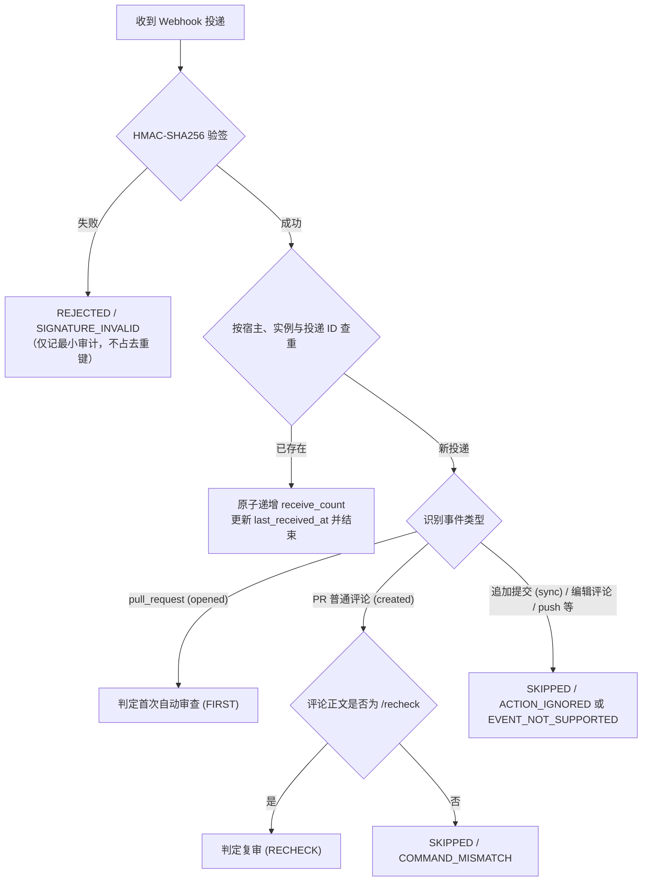

# PRA-01 双宿主接口、验签契约与验证基线

日期：2026-11-12。
对应 ROADMAP：[PRA-01 固定双宿主接口与验证样本](../../ROADMAP.md#pra-github-与-gitea-pr-自动审查2026-11-12)。
方案与原型依据：[PR 自动审查方案](README.md) · [交互原型](prototype.html)。

本文作为 PRA 工作包（GitHub 与 Gitea 1.16.1 PR 自动审查）的技术契约，固定两端 Webhook 协议与字段提取适配、HMAC-SHA256 验签算法、Git 宿主扩展能力契约、业务幂等键与状态机、运行与重试参数，并说明测试验证样本集。

---

## 1. 双宿主 Webhook 协议与字段适配

两端 Webhook 采用统一持久化与异步受理流程，但在请求头命名、验签前缀与评论事件格式上存在宿主专有特征。

### 1.1 请求头与验签格式

| 字段 | GitHub | Gitea 1.16.1 | 说明 |
| --- | --- | --- | --- |
| 投递 ID 头 | `X-GitHub-Delivery` | `X-Gitea-Delivery` | 宿主每次投递的唯一标识（UUID 字符串） |
| 事件名称头 | `X-GitHub-Event` | `X-Gitea-Event` | 顶层事件名（如 `pull_request`, `issue_comment`, `push`） |
| 详细事件头 | *(无)* | `X-Gitea-Event-Type` | Gitea 专有，区分 `pull_request`, `pull_request_comment`, `pull_request_sync`, `push` |
| 签名头 | `X-Hub-Signature-256` | `X-Gitea-Signature` | 签名头名称 |
| 签名格式 | `sha256=<64位十六进制小写摘要>` | `<64位十六进制小写摘要>` | GitHub 带有 `sha256=` 前缀，Gitea 为裸摘要 |
| 签名算法 | HMAC-SHA256 | HMAC-SHA256 | 密钥为项目配置的 Webhook Secret，按原始字节计算 |
| 比对安全性 | `MessageDigest.isEqual` | `MessageDigest.isEqual` | 必须使用常量时间比对，防范时序侧信道攻击 |

接收路径为 `POST /api/v2/webhooks/{hostType}`，也支持 `POST /webhooks/{hostType}`。请求体使用 JSON。GitHub 默认实例为 `github.com`。Gitea 实例取项目仓库地址的站点根，保留协议、非默认端口和站点子路径。SSH 仓库取 `git.gitea.api-base` 对应的站点根。

单 Gitea 站点可使用 `/webhooks/gitea`。项目绑定多个 Gitea 站点时，投递 URL 须指定 `instance`，例如 `/webhooks/gitea?instance=https%3A%2F%2Fgit.example.com%2Fgitea`。接收端只接受服务端已绑定的实例。

项目优先按实例内的 `repository.id` 匹配。项目未配置仓库 ID 时按仓库绑定的 `owner/repo` 匹配。验签失败返回 HTTP 401。投递 ID 缺失、超长或实例无法识别时返回 HTTP 400，拒绝记录仅保留最小审计信息。

### 1.2 事件识别与触发判定

系统仅对以下两类场景触发业务审查流程，其余均判定为「跳过（`SKIPPED`）」或「拒绝（`REJECTED`）」：



#### A. 首次审查触发（`trigger_kind = FIRST`）
- **GitHub**：
  - `X-GitHub-Event` 为 `pull_request`
  - 请求体 `action` 为 `opened`
- **Gitea 1.16.1**：
  - `X-Gitea-Event` 为 `pull_request`，且 `X-Gitea-Event-Type` 为 `pull_request`
  - 请求体 `action` 为 `opened`

#### B. 评论复审触发（`trigger_kind = RECHECK`）
- **复审命令**：去空格后精确等于 `/recheck`。行内提及、引用、多余文字均判定为 `COMMAND_MISMATCH`。
- **GitHub**：
  - `X-GitHub-Event` 为 `issue_comment`
  - 请求体 `action` 为 `created`
  - 请求体中包含非空的 `issue.pull_request` 节点（证明该评论依附于 PR 而非普通 Issue）
- **Gitea 1.16.1**：
  - `X-Gitea-Event` 为 `issue_comment` 且 `X-Gitea-Event-Type` 为 `pull_request_comment`
  - 请求体 `action` 为 `created`
  - 请求体字段 `is_pull == true`

#### C. 跳过场景与决策码
- **追加提交**：GitHub `pull_request (synchronize)`、Gitea `pull_request_sync` $\rightarrow$ `SKIPPED / ACTION_IGNORED`（追加提交不自动重审，待审核者主动发 `/recheck`）。
- **编辑或删除评论**：`action` 为 `edited` 或 `deleted` $\rightarrow$ `SKIPPED / ACTION_IGNORED`。
- **其他订阅事件**：如 `push` $\rightarrow$ `SKIPPED / EVENT_NOT_SUPPORTED`。
- **机器人自身发言**：`sender.id == project.botActorId` $\rightarrow$ `SKIPPED / BOT_COMMENT`（防止评论回写自身循环触发）。
- **审核者资格不符**：`sender.id` 不在 `project.reviewerUserIds` 白名单中 $\rightarrow$ `SKIPPED / REVIEWER_NOT_ALLOWED`。
- **目标分支不匹配**：`pull_request.base.ref != project.targetBranch` $\rightarrow$ `SKIPPED / TARGET_BRANCH_MISMATCH`。
- **项目未启用**：`project.autoReviewEnabled == false` $\rightarrow$ `SKIPPED / AUTO_REVIEW_DISABLED`。

### 1.3 关键字段抽取适配表

| 逻辑字段 | GitHub JSON 路径 | Gitea 1.16.1 JSON 路径 | 说明 |
| --- | --- | --- | --- |
| 仓库 ID | `repository.id` | `repository.id` | 宿主内的数值型仓库 ID（优先用于匹配系统项目） |
| 仓库全名 | `repository.full_name` | `repository.full_name` | 如 `owner/repo` |
| 触发人 ID | `sender.id` | `sender.id` | 宿主内的数值型用户 ID |
| 触发人登录名 | `sender.login` | `sender.login` | 用户账号名（脱敏展示） |
| PR 编号 | `number` 或 `issue.number` | `number` 或 `issue.number` | PR 业务序号 |
| PR 目标分支 | `pull_request.base.ref` | `pull_request.base.ref` | 新建 PR 事件中提取 |
| PR 源提交 SHA | `pull_request.head.sha` | `pull_request.head.sha` | 新建 PR 事件中的源提交 |
| 评论 ID | `comment.id` | `comment.id` | 评论事件中提取（用于复审去重） |
| 评论正文 | `comment.body` | `comment.body` | 评论文本（首尾去空白后匹配 `/recheck`） |

---

## 2. GitHostClient 扩展能力契约

在现有 `com.codereview.git.GitHostClient` 抽象中，扩展支持 PR 自动审查所需的用户查询与普通评论读写能力。

### 2.1 扩展方法签名

```java
public interface GitHostClient {
    // ... 既有 tree, rawFile, commits, pullRequests 等方法保持不变 ...

    /**
     * 按用户名查询用户基础身份（用于自动审查审核者白名单配置时解析用户 ID）。
     * 若用户不存在或凭据无权限，抛出 RESOURCE_NOT_FOUND (404)。
     */
    GitUserRef findUserByUsername(String token, Integer credentialType, GitRepoRef repoRef, String username);

    /**
     * 分页读取指定 PR / Issue 下的普通时间线评论（用于回写核对与未知状态恢复）。
     * 结果按评论创建时间升序排列，支持 hasMore 分页。
     */
    IssueCommentPage listIssueComments(String token, Integer credentialType, GitRepoRef repoRef,
                                       long issueNumber, int page, int perPage);

    /**
     * 在指定 PR / Issue 下发布一条普通时间线评论（用于回写审查任务链接）。
     * 正文应为 Markdown 超链接格式。返回发布成功的评论详情。
     */
    IssueComment createIssueComment(String token, Integer credentialType, GitRepoRef repoRef,
                                    long issueNumber, String body);
}
```

### 2.2 宿主 REST 接口映射对照

| 能力 | GitHub REST API | Gitea 1.16.1 REST API |
| --- | --- | --- |
| 用户查询 | `GET /users/{username}` | `GET /api/v1/users/{username}` |
| 评论列表 | `GET /repos/{owner}/{repo}/issues/{issue_number}/comments?page={page}&per_page={perPage}` | `GET /api/v1/repos/{owner}/{repo}/issues/{index}/comments?page={page}&limit={perPage}` |
| 评论发布 | `POST /repos/{owner}/{repo}/issues/{issue_number}/comments`<br>`Content-Type: application/json`<br>`{"body":"..."}` | `POST /api/v1/repos/{owner}/{repo}/issues/{index}/comments`<br>`Content-Type: application/json`<br>`{"body":"..."}` |

### 2.3 数据传输对象（DTO）

```java
public record GitUserRef(long id, String login, String name, String avatarUrl) {}

public record IssueComment(long id, long issueNumber, GitUserRef author, String body, Instant createdAt, Instant updatedAt) {}

public record IssueCommentPage(List<IssueComment> items, boolean hasMore, int page, int perPage) {}
```

---

## 3. 业务幂等键、任务回写与评论链接

### 3.1 业务幂等键（`business_key`）规范

为防止网络重试或多投递引起同一 PR 多次创建任务，处理记录在进入任务创建前必须获取业务唯一键：
- **算法**：`pr-auto-review:` + 64位十六进制小写的 SHA-256 哈希。
- **输入向量**：规范的 UTF-8 编码 JSON 数组，元素顺序固定为：
  - 首次审查：`[host_type, host_instance_key, repo_id, pr_number, "FIRST"]`
  - 评论复审：`[host_type, host_instance_key, repo_id, pr_number, "RECHECK", source_comment_id]`
- **并发互斥**：数据库唯一索引 `UNIQUE (project_id, business_key)`。首个取得唯一键的记录负责调用 `TaskService` 创建任务，后续重复记录置为 `SKIPPED / DUPLICATE_TRIGGER` 并记录 `canonical_record_id` 指向原记录。

### 3.2 任务回写与链接格式

1. **审查任务创建参数**（沿用 PRS 契约）：
   - `specialistType = ISSUE`
   - `source.kind = PR`
   - `smartSplit = false`
   - `projectId`、`modelConfigId`、`promptId`、`promptVersionId` 读取自项目自动审查配置
   - 目标文件列表筛选自本地镜像共同祖先到源提交的 `TEXT` 净变更
   - 任务名称格式为「PR #{pullNumber} 问题审查（自动触发） · {sourceHeadShortSha}」
2. **审查前端详情 URL 格式**：
   $$\text{reviewUrl} = \text{reviewBaseUrl} + \text{"/#/reviews/"} + \text{reviewTaskId} + \text{"?from=/reviews"}$$
   - `reviewBaseUrl` 来自项目配置（末尾自动去除 `/`，如 `https://review.example.com`）。
3. **回写评论 Markdown 正文模板**：
   ```markdown
   此评论由代码审查系统自动生成。

   [查看提交 {sourceHeadShortSha} 的审查进度与结果]({reviewUrl})
   ```
   - `{sourceHeadShortSha}` 为 `source_head` 前 7 位字符。

---

## 4. 运行参数、租约与重试机制

| 参数类别 | 参数项 | 设定值 | 说明 |
| --- | --- | --- | --- |
| 投递处理 | 处理租约时间 (`lease_duration`) | 300 秒（5 分钟） | 领取记录时更新 `lease_until`，进程异常崩溃后由后台扫描回收 |
| 评论重试 | 最大尝试次数 (`comment_max_attempts`) | 3 次 | 包括首次发送与重试 |
| 评论重试 | 退避间隔 (`comment_backoff_seconds`) | 30s, 60s, 120s | 指数递增等待退避 |
| 状态核对 | UNKNOWN 核对静默期 (`unknown_check_delay`) | 60 秒 | 评论请求超时进入 `UNKNOWN` 后，等待 60 秒再进行远端列表核对，避免并发假未发布 |
| 数据保留 | 请求体快照保留期 (`payload_retention_days`) | 30 天 | 超过 30 天已完成记录可清理 `payload_snapshot`，保留幂等键与审查回执 |
| 任务目标 | 单 PR 文本目标上限 (`max_text_targets`) | 500 个 | 超过 500 个文本目标记录 `VALIDATION_FAILED`，停止自动创建，转由人工介入 |
| 清单完整性 | 单 PR 文件变更总量上限 (`max_changed_files`) | 3000 个 | 超过 3000 个文件视为 `TRUNCATED`，记录 `SNAPSHOT_INCOMPLETE` 并停止 |

---

## 5. 验证样本集清单（Fixtures）

在 `backend/src/test/resources/fixtures/pra/` 准备 10 份脱敏测试样本：

1. `github/pull_request_opened.json`：GitHub 新建 PR 投递样本（目标分支 `main`，包含源分支与目标分支信息）。
2. `github/issue_comment_recheck.json`：GitHub 审核者发表 `/recheck` 普通评论样本（含 `issue.pull_request`）。
3. `github/pull_request_synchronize.json`：GitHub 追加提交 `synchronize` 样本。
4. `github/issue_comment_bot.json`：GitHub 机器人回写自身评论样本。
5. `github/issue_comment_regular_issue.json`：GitHub 普通 Issue 评论样本（无 `issue.pull_request`，验证跳过）。
6. `gitea/pull_request_opened.json`：Gitea 1.16.1 新建 PR 投递样本（`X-Gitea-Event-Type: pull_request`）。
7. `gitea/pull_request_comment_recheck.json`：Gitea 1.16.1 审核者发表 `/recheck` 评论样本（`X-Gitea-Event-Type: pull_request_comment`，`is_pull: true`）。
8. `gitea/pull_request_sync.json`：Gitea 1.16.1 追加提交样本（`X-Gitea-Event-Type: pull_request_sync`）。
9. `gitea/pull_request_comment_bot.json`：Gitea 1.16.1 机器人回写评论样本。
10. `common/signature_verification_cases.json`：包含预设密钥、原始请求载荷及对应的 GitHub / Gitea 签名计算与非法篡改用例。
