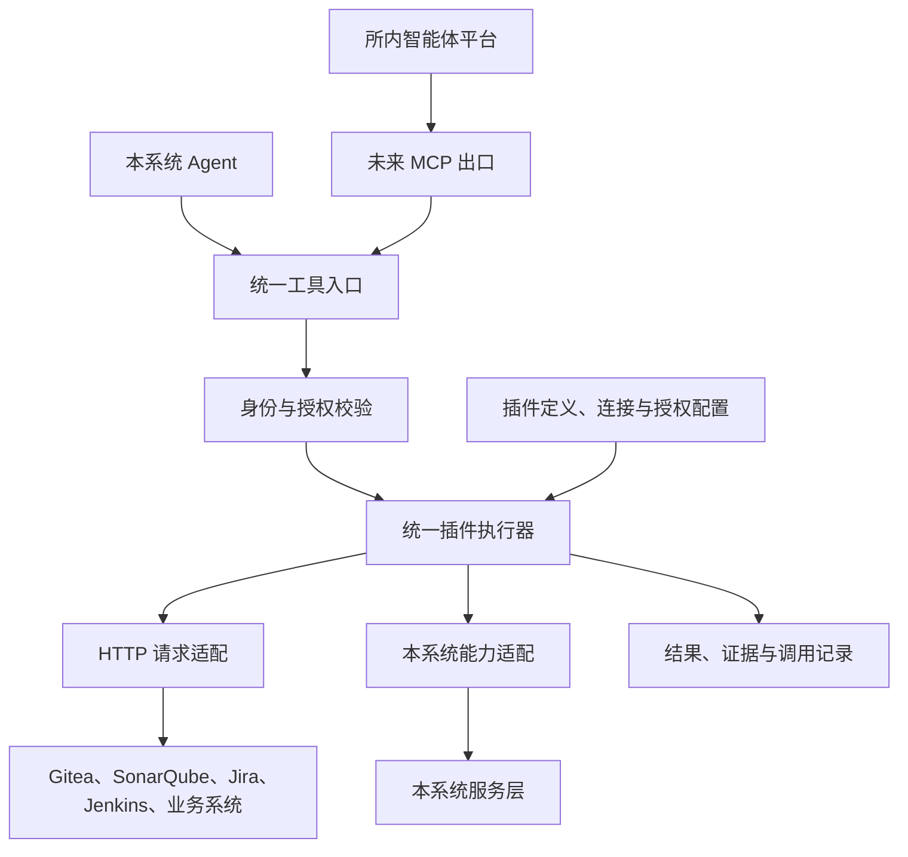

# JSON 形式插件与统一插件执行器设计讨论

日期：2026-11-01。状态：讨论归档与设计建议，尚未进入框架实施。

本文汇总本会话关于内网系统接入、JSON 形式插件、统一插件执行器、Agent 复用及 MCP 出口的讨论，作为后续需求细化和设计评审的入口。读者包括项目负责人及后续设计、开发人员。

已有成果为 [Gitea 1.16.1 基础插件 JSON](examples/gitea-1.16.1-basic.plugin.json)及其[使用说明](examples/README.md)，提交为 `ce8ae41`。样例仅完成离线核对，不代表现有系统已经能够导入、授权或执行插件。

2026-11-03 补充材料：[设计讨论纪要](discussion-2026-11-03.md)、[前端工作量评估](frontend-workload-2026-11-03.md)、[Skill／插件分析 UX 示意](skill-analysis-prototype/README.md)。该 HTML 只表达流程与信息结构。正式 Vue／Ant Design 界面必须跟随主干现有 Agent 页面；不要把该 HTML 的样式、弹窗或抽屉抄进 `src/`。

## 1. 方向、建议与待确认事项

下表区分负责人提出的方向与会话中的设计建议。本文落盘不等于其中全部建议已经批准，也不表示已授权业务代码、数据库、部署或外部系统操作。

| 类别 | 内容 | 当前定位 |
| --- | --- | --- |
| 负责人提出 | 使用统一 schema 的 JSON 描述接口、授权规则、使用指南及有限适配配置，通过导入接入插件 | 核心产品方向，正式 schema 待设计 |
| 负责人提出 | 用户在类似 Agent 分析的界面勾选能力，按所选能力提供提示词及工具说明 | 核心交互方向，页面结构待原型确认 |
| 负责人提出 | 本系统自身的接口也可以提供给 LLM 调用 | 扩展方向，开放范围待确认 |
| 会话推演 | 框架先服务本系统 Agent，再通过 MCP 出口服务所内智能体开发平台 | 架构演进方向，协议及平台联调未开展 |
| 设计建议 | 分离插件定义、连接配置与实际授权，执行层按操作白名单落实权限 | 后续详细设计依据候选 |
| 设计建议 | 新增插件任务入口，逐步提取现有 Agent 公共执行核心，保留代码任务的业务约束 | 尚待负责人确认的实施方案 |

现有代码审查规则仍以[专项审查与 Agent 分析业务契约](../agent-redesign/business-contract.md)为准。本文不修改现有 Agent 的只读范围、固定代码版本、容量终止或任务恢复规则。

## 2. 需要解决的问题与应用价值

内网已部署 Jira、SonarQube、Jenkins，以及可能需要接入的业务系统。这些系统的版本、认证和接口形式不同，现成连接器不一定适用；原系统也未必便于升级。若每次接入都为接口编写专用工具，维护工作会随系统数量增加。

目标是在框架支持的请求与认证范围内，将常见接入工作收敛为「制作插件 JSON、导入、绑定连接、授权、验证」。特殊协议仍通过可信适配器补充，不承诺单个 JSON 能覆盖所有系统。

| 场景 | 组合能力 | 预期价值与前提 |
| --- | --- | --- |
| 需求与实现核对 | Jira 需求、验收条件及固定版本代码 | 逐项核对实现与缺失材料；需区分正式需求、讨论和过期描述 |
| 扫描发现调查 | SonarQube 发现与代码工具 | 调查影响及修复依据；保留扫描原判与 Agent 补充分析 |
| 构建失败排查 | Jenkins 构建、错误材料及代码变化 | 缩短材料准备和调查过程；需核对构建实际使用的提交 |
| 发布材料汇总 | 需求、代码、扫描与构建结果 | 汇总完成情况、检查证据和剩余风险；不自动等同发布批准 |
| 业务缺陷调查 | 业务状态、过程记录、运行版本及代码 | 将实际现象与代码路径关联；可靠性取决于数据出口及版本关系 |

跨系统材料需要明确关联依据。Jira 单据、Git 提交、Sonar 扫描、Jenkins 构建及运行版本不能仅按项目名称或时间接近就视为同一批成果。第一批可以由用户显式选择关联对象，自动关联作为后续能力。

## 3. 概念与职责

| 概念 | 本方案中的含义 |
| --- | --- |
| 业务接口 | 被接入系统提供给程序的访问入口 |
| 工具 | 面向模型暴露的能力名称、用途、参数及执行结果 |
| 插件 JSON | 可导入的能力定义与适配配置，不包含实际凭证，不自行执行代码 |
| 统一插件执行器 | 解释配置，校验权限及参数，组装和执行请求，整理结果并记录调用 |
| Agent | 根据任务要求选择工具，读取结果并继续调查或提交结论的执行机制 |
| MCP | AI 应用发现和调用工具等能力的通信协议；具体接口适配仍由服务端完成 |

OpenAPI／Swagger 可作为接口路径、参数和响应的导入来源。插件还需要补充授权要求、使用指南、响应映射及框架适配配置。接口文档说明「怎样调用」，实际授权决定「是否允许调用」。

## 4. 总体结构



统一插件执行器作为独立模块设计，通过内部接口供 Agent 使用。工具发现、调用、结果返回与业务接入实现分离，便于后续增加 MCP 出口。HTTP 适配与本系统能力适配共用授权、限额和调用记录，执行方式可以不同。

## 5. 三类配置分离

| 配置 | 主要内容 | 维护边界 |
| --- | --- | --- |
| 插件定义 | 标识、版本、操作、参数、请求映射、响应处理、指南、适配器要求、权限要求 | 可导入和分享；声明所需能力，不自行取得权限 |
| 连接配置 | 实例地址、部署子路径、认证方式、服务端凭证引用、目标版本 | 由有权配置连接的人员绑定，真实凭证不进入导出文件或模型消息 |
| 实际授权 | 使用者、允许的连接与操作、项目／仓库范围、资源限额 | 由可信管理配置决定，用户勾选能力不能扩大已有权限 |

同一份插件可以绑定多个连接。例如，Gitea 插件分别连接研发和测试实例，每个连接使用独立凭证和仓库范围。

有效权限取平台允许范围、调用者权限、连接授权、任务所选范围和目标系统权限的交集。后端在发现、说明及执行阶段均核对授权；任务快照用于追溯，当前撤权不能被旧快照绕过。撤权对在途请求的具体处置待详细设计。

## 6. 插件 JSON 的建议结构

正式 schema 尚未定稿，现有 `0.1.0-draft` 仅是验证样例。本表说明候选结构，不将样例中的字段名、数值或组织方式全部固定为正式规范。

| 内容 | 建议表达的信息 |
| --- | --- |
| 版本与元数据 | schema 版本、插件标识与版本、目标产品／版本、来源及验证边界 |
| 操作目录 | 唯一操作编号、用途、参数结构、效果分类、请求及响应定义 |
| 输入约束 | 类型、必填项、枚举、长度与数值边界、未知参数处理 |
| 请求映射 | 方法、路径模板、参数位置、固定值、默认值、缺省规则、内容类型及编码 |
| 响应处理 | 预期状态码、响应类型、字段提取、分页及完整性标记 |
| 权限要求 | 申请开放的操作、资源范围及所需执行能力；不替代实际授权 |
| 使用指南 | 调查顺序、业务含义、错误恢复、版本限制、结果解读边界及示例 |
| 适配要求 | 所需内置认证／转换适配器编号与最低能力要求 |

参数结构尽量采用 JSON Schema；请求体、参数序列化等概念参考 OpenAPI。标准文档导入后仍需核对目标实例版本、实际业务效果及授权规则，不能把接口名称或说明中的「只读」自动当作可信授权依据。

### 6.1 请求构造的支持边界

复杂嵌套 JSON 本身不一定需要专用代码。主要需要明确输入结构、字段映射、请求内容类型和序列化规则。

| 形式 | 建议支持顺序 | 处理方式 |
| --- | --- | --- |
| 路径、查询参数及 JSON 响应 | 第一批 | 参数结构校验、单段路径编码、明确查询序列化方式 |
| JSON body、普通表单 body | 在基础查询验证后补充 | 构造对象或表单，再由对应编码器序列化 |
| multipart、文件上传下载 | 按实际需求决定 | 单独定义文件来源、体积、存储和访问边界 |
| XML、特殊签名及多阶段交互 | 需要时增加适配器 | 超出已支持能力时拒绝导入或启用，不尝试自由拼装 |

第一批 Gitea 样例只有选定的 GET 查询，不覆盖 POST body。后续允许查询用途的 POST 时，按具体操作授权；HTTP 方法不单独决定业务安全性，幂等也不表示不会修改数据。

### 6.2 有限适配配置

JSON 可描述字段改名、固定值、默认值、结果路径、分页规则及有限格式转换。配置应有明确类型和边界，不提供任意脚本、动态类加载、Shell 或可执行表达式入口。

特殊逻辑由随系统版本发布的可信适配器实现，JSON 仅引用适配器编号和已定义参数。新增这种能力可能需要开发和部署，不能继续承诺只导入文件就能接入。

### 6.3 认证配置

认证类型按首批实例的实际需要选择，候选包括固定 API Key、Basic 和 Bearer。OAuth 刷新、动态签名等需要状态或计算的方式由专门模块处理，支持顺序待确认。

凭证由服务端读取并注入。模型不能读取、选择任意凭证或覆盖认证头。连接选择、服务账号权限及日志脱敏均由服务端控制；插件只声明自己需要哪类认证能力。

## 7. 导入、更新与使用流程

以下是拟议流程，现有页面尚未实现。第一批界面按工作区规则先制作独立 HTML 原型，再进入框架实现。

1. 上传 JSON 或粘贴内容。系统检查大小、语法、schema 版本、操作编号唯一性及所有结构约束。
2. 校验运行时能力。遇到不支持的认证、编码、转换、外部引用或执行要求时拒绝导入，不能忽略安全字段后继续。
3. 预览操作和权限。管理员核对接口效果，决定实际开放范围；导入成功不等于授权成功。
4. 创建或绑定连接。填写实例地址，绑定服务端凭证，设置非空的项目／仓库范围。
5. 执行明确选定的连接验证。只调用获准验证操作，不自动尝试所有接口或创建测试数据。
6. 启用插件连接。用户发起任务时选择自己有权使用的能力，再填写本次要求及资源范围。

更新插件时展示版本、接口、映射及权限差异。新增操作不自动取得授权。任务保留使用的定义版本、内容摘要及有效配置快照，插件更新不改写历史记录；具体发布、回退及在途变更机制待定。

## 8. 工具发现与提示词组装

任务开始时只加入所选能力概览与必要规则。接口很多时，按需提供操作说明，避免把全部文档同时塞入上下文。

建议提供搜索操作、读取操作说明、执行操作三类内部能力；`search_operations`、`describe_operation`、`execute_operation` 仅为会话中的候选名称，正式接口待定。少量常用操作也可直接暴露为独立工具。

操作身份需要同时区分插件、连接、定义版本和操作编号，避免多个插件的同名操作混淆。模型能看到的目录、说明和最终可执行范围应一致；即使模型自行推测出操作编号，执行层也必须独立校验。

提示词继续由统一组装入口处理。插件指南只能补充使用方式和业务背景，不能覆盖程序边界、授权或输出约定。接口响应、Issue、评论、源码和日志都属于材料，其中出现的指令不能增加权限或触发额外网络访问。

## 9. 统一执行器的调用流程

### 9.1 输入示意

下列内容表示模型提交的业务参数，不是现有系统已经发布的 API。连接由任务已授权绑定确定；若允许模型在多个连接中选择，也必须限制在本任务获准集合内。

```json
{
  "operationId": "repoGetPullRequest",
  "arguments": {
    "owner": "example-team",
    "repo": "example-repo",
    "index": 12
  }
}
```

### 9.2 执行顺序

1. 解析操作身份，取得任务绑定的插件定义和连接。未知、禁用或不兼容操作立即拒绝。
2. 检查调用者、连接、操作和资源范围；检查取消、期限、额度及并发限制。
3. 校验输入，拒绝未知参数，按明确规则补齐默认值。JSON Schema 的 `default` 不能被当作校验器必然执行的赋值动作。
4. 绑定路径、查询或 body 字段。使用标准编码和序列化器，禁止通过字符串拼接生成 JSON 或命令。
5. 由连接配置确定目标并校验最终地址。服务端读取凭证、注入认证及固定请求头。
6. 在截止时间和体积限制内执行请求。按具体操作的重试规则处理暂态故障，每次真实尝试计数。
7. 检查 HTTP 状态、内容类型和响应结构，再按规则提取数据。超限、解析错误和截断不能转换为空成功结果。
8. 保存脱敏调用记录与可引用材料，将状态、完整性、分页信息和数据返回给 Agent。

例如，上述 PR 操作根据插件定义使用 `GET /repos/{owner}/{repo}/pulls/{index}`。执行器追加 API 前缀、编码参数后，再注入 `Authorization: token <服务端凭证>`。模型无须也不能提交完整请求。

地址组合须保留实例部署子路径。模型不可控制目标 origin、路径模板、请求方法、认证头或任意请求头。响应中的网页、diff、附件或分页链接仅是数据，不能自动成为新的请求授权。

## 10. 安全、失败与证据边界

### 10.1 执行层约束

| 约束 | 拟议执行要求 |
| --- | --- |
| 操作 | 默认拒绝未登记操作；核对固定方法、路径与内容类型，不能只禁止 DELETE 或只允许 GET |
| 资源 | 校验对象属于实际授权项目／仓库；同一服务器上的其他对象不自动获准 |
| 网络 | 固定连接目标及允许的解析地址／部署路径，防止地址替换；默认不跟随重定向 |
| 参数 | 拒绝未定义参数、方法覆盖、身份冒用及认证覆盖；路径规范化和编码后再次核对授权 |
| 凭证 | 服务端管理与注入，不进入模型消息、分享内容或普通调用日志；按权限支持情况选择受限账号 |
| 资源消耗 | 限制调用、分页、响应体积、并发和总期限；参数错误和重试同样计入相应限额 |
| 配置可信度 | schema 合法不代表操作安全；指南、权限标签和只读声明不能自行授予执行权 |

内网接入不能通过「禁止所有内网地址」处理网络边界，应精确允许已配置的目标。分页若使用返回链接，只提取并校验可接受的续页参数，继续调用同一登记操作，避免直接跟随任意 URL。

### 10.2 失败结果

输入错误、权限拒绝、认证失败、超时、网络错误、响应超限、解析失败和目标不存在应能区分。具体错误码尚未定稿；HTTP 状态、单次工具状态、查询完整性和任务终态分别记录。

401／403 不伪装成空结果；404 可能涉及不可见对象，不能直接断言对象不存在。暂态错误只允许有限重试，副作用操作及结果未知的请求不能沿用查询请求的重试策略。

### 10.3 证据与结果

结果至少能追溯插件定义版本、连接身份、操作编号、脱敏参数、取得时间、响应摘要和实际送给模型的内容。具体保存字段、保留策略及访问控制待定。

代码证据保留 SHA、路径和行范围；接口证据记录业务对象、查询条件、取得时间及系统提供的版本标识，不虚构 SHA 或行号。只有实际取得并送入模型的材料才可引用。字段提取、净化和体积处理不能改变材料含义；原始材料与投影材料的保存边界需明确。

列表分页未读完、结果截断或响应无法判断全量时，返回部分或未知完整性。实时列表不承诺跨页快照一致。合法引用只证明来源和范围可追溯，不自动证明模型结论正确。

## 11. 与现有 Agent 的复用方案

建议在同一应用内新增插件任务入口与任务定义，逐步提取公共执行核心。现有代码 Agent 保留固定版本代码调查的输入、权限及结果约束。此为实施建议，尚未批准改造。

| 能力 | 建议处理 |
| --- | --- |
| 模型调用、消息组织、容量检查 | 复用公共能力，工具目录改为按任务生成 |
| 多轮循环、显式提交、取消及迟到响应保护 | 提取公共执行机制，业务规则由任务适配层提供 |
| 调用记录、长内容阅读及进度组件 | 优先复用，不要求全部页面重写 |
| 插件任务输入 | 独立表达所选连接、能力、资源范围和要求；纯查询任务不强制选择代码仓库 |
| 工具调用与证据 | 增加插件执行及多来源证据适配，保留现有代码证据语义 |
| 存储与结果发布 | 先分析现有生命周期和记录的复用范围，避免填入虚假的项目、SHA 或行号；不预先决定重建全部表 |

当前约束可核对 [AgentTaskDtos](../../../backend/src/main/java/com/codereview/agent/dto/AgentTaskDtos.java)、[AgentTaskWorker](../../../backend/src/main/java/com/codereview/agent/execution/AgentTaskWorker.java)及 [ToolEnvelope](../../../backend/src/main/java/com/codereview/agent/tools/ToolEnvelope.java)。预算、分页及失败样本参考[P33 实验记录](../agent-redesign/p33/budget-calibration.md)，现有数值不是新插件任务的实测依据。

## 12. 本系统能力接入

本系统可以通过内置适配器登记工具。内部调用可直接经过服务层，但仍执行调用者权限、预算、参数和业务校验，不因省略 HTTP 而绕过控制。

| 能力 | 建议顺序 |
| --- | --- |
| 查询项目、历史审查结果、调用及报告 | 优先评估 |
| 创建专项分析、生成报告 | 后续开放，视为有副作用操作 |
| 创建 Agent、删除记录、修改模型、管理凭证或授权 | 初期关闭，单独讨论 |

创建任务会消耗模型资源、占用队列并产生记录，即使不修改被审源码，也需要独立授权。开放前明确父子任务关系、幂等键、整条任务链预算、取消传播和异步等待；避免无界递归，也避免父任务占满共享执行资源等待子任务而无法推进。不得用未受控的密集轮询代替等待机制。

## 13. 未来 MCP 出口

本系统可以作为所内智能体平台与内网业务系统之间的适配服务。插件 JSON 和统一执行器负责具体接入，MCP 出口负责按协议提供工具目录、调用与结果。原业务系统通常不需要自行实现 MCP，但仍需有可用的数据访问方式。

MCP 出口与内置 Agent 共用受控执行入口。对外暴露时，需要将平台调用身份映射到本系统的连接、操作及资源授权，不能直接继承系统保存的全部凭证权限。MCP 侧认证与业务系统侧认证是两段不同的认证关系。

第一批不要求 MCP。后续接入仍需完成协议适配、身份授权、名称隔离、结果和错误映射及平台联调，不是仅修改一个协议标记。新增插件能否立即出现在平台上，还取决于平台的工具刷新、同步或启用机制。协议版本和平台兼容范围届时核对。

插件只覆盖框架支持的请求形式；MCP 不替代特殊接口适配工作。已有 `gitea-1.16.1-basic.plugin.json` 也不是 MCP 客户端可以直接执行的标准配置。

## 14. 分批验证建议与待定设计

建议先完成「JSON 导入、连接授权、单次查询、证据保存、Agent 使用」闭环，再增加复杂请求、本系统任务组织及 MCP 出口。此顺序属于建议，不是新阶段排期。

| 验证范围 | 验证重点 |
| --- | --- |
| 导入及能力匹配 | 格式错误、重复编号、不支持的能力、未知安全字段和未授权新增操作明确拒绝 |
| 请求组装 | 路径、查询、默认值、部署子路径与编码正确；后续单独补充 JSON／表单 body |
| 认证与范围 | 身份可核对，凭证不进入模型或普通日志，越权仓库和连接不能执行 |
| 执行边界 | 未登记操作、地址替换、重定向、参数覆盖和材料诱导不能绕过执行规则 |
| 返回及证据 | 空结果、错误、超限、分页和未知完整性分别表达，引用指向实际材料 |
| Agent 复用 | 纯插件任务可运行；原代码任务的固定版本、预算、取消、结果及引用规则保持有效 |
| 目标实例 | 在明确指定的内网实例核对版本、认证、真实响应及授权效果，离线样例不替代实测 |

已有 Gitea 样例登记 7 个查询操作，操作列表以[样例说明](examples/README.md)为准，不在本文重复维护。其页数、每页条数、名称字符及超时限制均为验证配置，不能直接作为全部插件的正式默认值。

后续需要定稿：正式 JSON Schema 及兼容规则、操作身份格式、首批认证与编码类型、授权管理模型、插件更新与撤权机制、证据存储与保留策略、任务及页面结构、资源计量和重试分类、本系统开放范围、MCP 版本及平台联调方式。数据库、运行依赖及部署变化在实施设计中逐项说明。

## 15. 本次落盘与参考

本次仅整理设计讨论、关联已有样例并补充接续入口。未实现插件框架、制作页面原型、变更业务契约、执行数据库操作、启停服务或调用内网系统；不改变既有工作包的验收状态。

参考资料用于理解概念及核对既有样例，不代表已选择正式协议版本或覆盖所有目标版本：

- [OpenAPI 3.1.1 规范](https://spec.openapis.org/oas/v3.1.1.html)：HTTP 接口描述与参数、请求体和响应结构。
- [MCP 架构说明](https://modelcontextprotocol.io/docs/learn/architecture)：应用、客户端与工具服务的关系。
- [MCP 2025-11-25 工具说明](https://modelcontextprotocol.io/specification/2025-11-25/server/tools)：工具描述、发现和调用的参考。
- [Gitea v1.16.1 Swagger 定义](https://github.com/go-gitea/gitea/blob/v1.16.1/templates/swagger/v1_json.tmpl)：已生成样例的接口来源。
- [OWASP 服务端请求伪造防护说明](https://cheatsheetseries.owasp.org/cheatsheets/Server_Side_Request_Forgery_Prevention_Cheat_Sheet.html)：固定目标、重定向及网络访问边界的参考。
